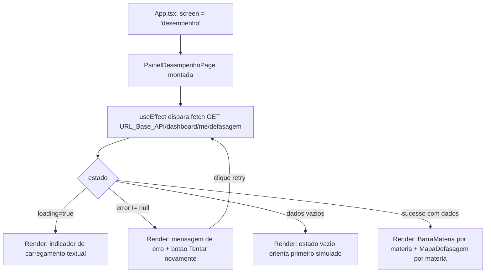
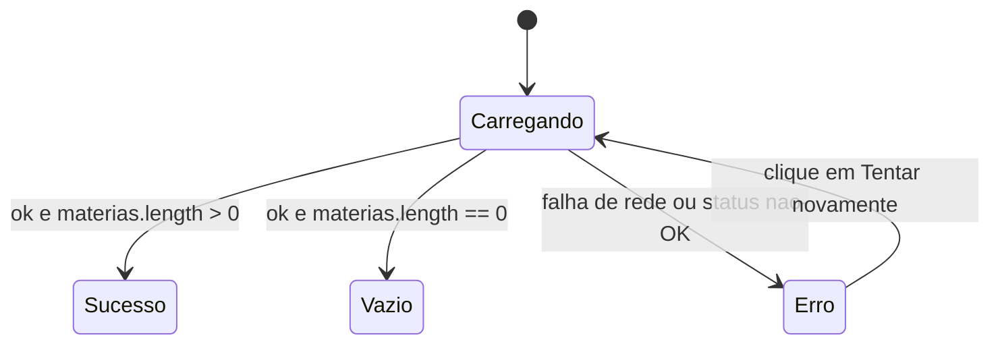

# Design Document

## Overview

Este documento descreve o design do **Painel_Individual** (subtarefa CHA-30), um painel de frontend somente leitura que mostra ao Aluno autenticado (a) um **gráfico de desempenho por Matéria** (barras horizontais de percentual de acerto, visão macro) e (b) um **Mapa_De_Defasagem por Conteúdo/conceito** dentro de cada Matéria, com nível de defasagem baixa/média/alta.

O escopo é exclusivamente `apps/frontend` (React 19 + TypeScript + Vite). O painel consome o **Endpoint_De_Defasagem** (`GET /dashboard/me/defasagem`) por **contrato de dados** — a implementação do endpoint não faz parte desta spec (atende a Introdução e os Pontos de Atenção do requirements). O design define o shape tipado da resposta, o comportamento de carregamento/erro/vazio/sucesso e a integração com a navegação por estado existente.

Princípios de design herdados do repositório (confirmados por leitura dos arquivos):

- **Sem novas dependências.** `apps/frontend/package.json` declara apenas `react` e `react-dom`. As visualizações são feitas em CSS/SVG puro (atende Requirement 3.1 e 4.1).
- **Reuso do `Servico_De_Cores`** (`src/utils/colors.ts`): `theme` e `getDificuldadeColors` (atende Requirement 3.4 e 4.3).
- **Mesmo padrão de busca de dados** de `src/pages/result_simulado.page.tsx`: `useEffect` + `fetch` com `useState` para dados/loading/error e *early returns* por estado (atende Requirement 2 e Requirement 5).
- **Navegação por estado** em `src/App.tsx`, sem roteador (atende Requirement 8).

## Architecture

### Encaixe na navegação por estado

A aplicação não tem roteador; a navegação é controlada por `type Screen` + `useState` em `src/App.tsx`. O painel é adicionado como um novo valor desse *union* e renderizado condicionalmente, recebendo um callback `onBack`, exatamente como as telas existentes (`'result'` já segue esse formato).

Ponto de edição em `src/App.tsx`:

```typescript
// 1. Importar a página
import { PainelDesempenhoPage } from './pages/PainelDesempenho.page'

// 2. Adicionar o valor ao union (atende Requirement 8.1)
type Screen = 'home' | 'cadastro' | 'login' | 'redefinir' | 'result' | 'desempenho'

// 3. Renderizar condicionalmente, passando onBack (atende Requirement 8.2)
if (screen === 'desempenho') {
  return <PainelDesempenhoPage onBack={() => setScreen('home')} />
}
```

> Decisão: o valor do union é `'desempenho'` (e não `'painel'`) por ser mais descritivo do conteúdo. O botão de retorno fica dentro da própria página (como `ResultPage` o faz hoje via wrapper), mantendo o `App.tsx` enxuto.

### Fluxo de dados: fetch → estado → render



A máquina de estados segue literalmente o padrão de `result_simulado.page.tsx`: três *early returns* (`loading`, `error`, dados ausentes/vazios) antes do render de sucesso. A única adição é o botão de nova tentativa no estado de erro (Requirement 5.2/5.3).

### Camadas e responsabilidades

| Camada | Arquivo | Responsabilidade |
| --- | --- | --- |
| Tipos (contrato) | `src/types/desempenho.types.ts` | Shape tipado da resposta do Endpoint_De_Defasagem (Requirement 1) |
| Utilitário de cor | `src/utils/colors.ts` (nova função) | Mapear Nivel_De_Defasagem → paleta via `getDificuldadeColors` (Requirement 4.3) |
| Página/container | `src/pages/PainelDesempenho.page.tsx` | Fetch, estados, orquestração e navegação (Requirements 2, 5, 6, 8) |
| Apresentação | `BarraMateria`, `MapaDefasagem`, `CelulaConteudo` | Render puro a partir de props (Requirements 3, 4, 7) |
| Estilo | `src/pages/PainelDesempenho.css` | Barras, grade do mapa e layout |

## Components and Interfaces

Os componentes recebem dados por props tipadas (convenção confirmada em `QuestionCard.tsx`). Os subcomponentes de apresentação são **puros** (sem fetch), o que concentra o I/O na página e facilita teste manual e evolução futura.

### `PainelDesempenhoPage` (container)

`src/pages/PainelDesempenho.page.tsx` — espelha a estrutura de `ResultPage`.

```typescript
interface PainelDesempenhoPageProps {
  onBack: () => void; // Requirement 8.2
}

export function PainelDesempenhoPage({ onBack }: PainelDesempenhoPageProps) {
  const [dados, setDados] = useState<RespostaDefasagem | null>(null);
  const [loading, setLoading] = useState<boolean>(true);
  const [error, setError] = useState<string | null>(null);

  // Extraído para permitir reuso no botão "Tentar novamente" (Requirement 5.3)
  async function carregarDefasagem() { /* fetch + setState, padrão result_simulado */ }

  useEffect(() => { carregarDefasagem(); }, []); // Requirement 2.1

  // early returns: loading / error+retry / vazio / sucesso (ver Error Handling)
}
```

Comportamento-chave:

- Compõe a URL a partir da `URL_Base_API` `http://localhost:3000` (Requirement 2.4): `fetch('http://localhost:3000/dashboard/me/defasagem')`.
- `carregarDefasagem` é uma função nomeada reutilizável (não anônima dentro do `useEffect`) para que o botão de nova tentativa invoque exatamente a mesma lógica (Requirement 5.3).
- Renderiza, no sucesso, uma seção por Matéria: cabeçalho com `BarraMateria`, seguido do `MapaDefasagem` daquela Matéria, agrupando visualmente os Conteúdos à sua Matéria de origem (Requirement 4.4).

### `BarraMateria` (apresentação)

Renderiza uma barra horizontal de percentual de acerto por Matéria (Requirement 3).

```typescript
interface BarraMateriaProps {
  nome: string;            // nome da Matéria
  percentualAcerto: number; // 0..100
  acertos: number;
  totalQuestoes: number;
}
```

Regras:

- Comprimento da barra proporcional ao percentual: `width: ${clamp(percentualAcerto, 0, 100)}%` (Requirement 3.3).
- Exibe como texto legível: nome da Matéria, percentual e a razão `acertos/totalQuestoes` (Requirement 3.2, 7.1).
- Cor da barra vinda do `Servico_De_Cores` (Requirement 3.4) — ver seção *Decisões de design*.
- Acessibilidade: a barra usa `role="meter"` com `aria-valuenow`, `aria-valuemin={0}`, `aria-valuemax={100}` e um `aria-label` descritivo (ex.: `"Matemática: 72% de acerto, 36 de 50 questões"`). O texto numérico fica visível ao lado da barra, de modo que a informação nunca dependa só da cor (Requirement 7.1, 7.4).

### `MapaDefasagem` e `CelulaConteudo` (apresentação)

`MapaDefasagem` renderiza a lista de Conteúdos de uma Matéria; `CelulaConteudo` renderiza cada item.

```typescript
interface MapaDefasagemProps {
  materia: string;         // para rótulo/agrupamento (Requirement 4.4)
  conteudos: Conteudo[];
}

interface CelulaConteudoProps {
  nome: string;
  percentualAcerto: number; // 0..100
  nivel: NivelDefasagem;    // "baixa" | "média" | "alta"
}
```

Regras:

- `MapaDefasagem` usa uma `<ul>` semântica de `CelulaConteudo` (`<li>`), sob um cabeçalho que nomeia a Matéria (Requirement 4.4, 7.2).
- `CelulaConteudo` exibe nome, percentual e o `Nivel_De_Defasagem` como **texto legível** (Requirement 4.2, 7.1), além de aplicar as cores de fundo/texto do nível (Requirement 4.3).
- Cores obtidas por `coresDoNivelDefasagem(nivel)` (abaixo), que reutiliza `getDificuldadeColors` sem duplicar paleta.

### Função de mapeamento nível → cor

Adicionada a `src/utils/colors.ts`, reutilizando `getDificuldadeColors` (Requirement 4.3). O `Nivel_De_Defasagem` usa "baixa"/"média"/"alta", enquanto `getDificuldadeColors` conhece "fácil"/"média"/"difícil". O mapeamento traduz **semântica de desempenho** para **semântica de paleta**:

| Nivel_De_Defasagem | Significado | Chave em getDificuldadeColors | Cor |
| --- | --- | --- | --- |
| `baixa` | melhor desempenho | `fácil` | verde (`#dcfce7` / `#166534`) |
| `média` | intermediário | `média` | amarelo (`#fef08a` / `#854d0e`) |
| `alta` | pior desempenho (reforçar) | `difícil` | vermelho (`#fee2e2` / `#b91c1c`) |

```typescript
// src/utils/colors.ts
export type NivelDefasagem = 'baixa' | 'média' | 'alta';

// defasagem ALTA = pior -> vermelho de 'difícil'; BAIXA = melhor -> verde de 'fácil'
const NIVEL_PARA_DIFICULDADE: Record<NivelDefasagem, string> = {
  baixa: 'fácil',
  média: 'média',
  alta: 'difícil',
};

export const coresDoNivelDefasagem = (nivel: NivelDefasagem) =>
  getDificuldadeColors(NIVEL_PARA_DIFICULDADE[nivel]);
```

> A inversão semântica (defasagem alta = vermelho) é o ponto mais propenso a erro do design e está isolada nessa função pura para facilitar revisão e verificação (ver Correctness Properties).

## Data Models

Contrato de dados em `src/types/desempenho.types.ts` (convenção `snake_case.types.ts` confirmada em `resultado_simulado.types.ts`). Atende Requirement 1 por completo.

```typescript
// src/types/desempenho.types.ts

// Requirement 1.4: valores restritos
export type NivelDefasagem = 'baixa' | 'média' | 'alta';

// Requirement 1.3: um Conteúdo do Mapa_De_Defasagem
export interface Conteudo {
  nome: string;             // nome do Conteúdo
  percentualAcerto: number; // 0..100
  nivel: NivelDefasagem;
}

// Requirement 1.2 + 1.1: Desempenho_Por_Materia + Mapa_De_Defasagem aninhado
export interface DesempenhoPorMateria {
  materia: string;          // nome da Matéria
  totalQuestoes: number;    // total de questões respondidas
  acertos: number;          // total de acertos
  percentualAcerto: number; // 0..100
  mapaDefasagem: Conteudo[]; // Mapa_De_Defasagem desta Matéria
}

// Requirement 1.1: resposta do Endpoint_De_Defasagem (lista de matérias)
export interface RespostaDefasagem {
  materias: DesempenhoPorMateria[];
}
```

> Observação de tipo: `NivelDefasagem` é definido no contrato (`desempenho.types.ts`) e reexportado/reutilizado por `colors.ts` para manter uma única fonte de verdade da união literal.

Exemplo de JSON esperado do endpoint (apenas ilustrativo do shape):

```json
{
  "materias": [
    {
      "materia": "Matemática",
      "totalQuestoes": 50,
      "acertos": 36,
      "percentualAcerto": 72,
      "mapaDefasagem": [
        { "nome": "Funções do 2º grau", "percentualAcerto": 40, "nivel": "alta" },
        { "nome": "Probabilidade", "percentualAcerto": 85, "nivel": "baixa" }
      ]
    }
  ]
}
```

O estado vazio corresponde a `{ "materias": [] }` (Requirement 6).

## Correctness Properties

*Uma propriedade é uma característica ou comportamento que deve valer em todas as execuções válidas do sistema — uma afirmação formal sobre o que o sistema deve fazer. Propriedades servem de ponte entre especificações legíveis por humanos e garantias de correção verificáveis por máquina.*

Esta feature é majoritariamente renderização de UI e I/O (fetch), para os quais PBT não é a ferramenta adequada (ver Testing Strategy). A prework identificou **uma** lógica genuinamente pura e propensa a bug — o mapeamento Nivel_De_Defasagem → cor — além do dimensionamento proporcional da barra. Essas propriedades ficam registradas conceitualmente; **hoje não há runner de testes em `apps/frontend`, portanto não serão automatizadas nesta spec** (não se deve introduzir framework de PBT inexistente). Elas orientam a revisão de código e a verificação por tipagem exaustiva.

### Property 1: Mapeamento nível → cor é total e semanticamente coerente

*Para todo* `nivel` em `{ "baixa", "média", "alta" }`, `coresDoNivelDefasagem(nivel)` retorna um par `{bg, text}` definido, nunca o `default` de `getDificuldadeColors`, e respeita a correspondência fixa: `baixa` → verde (`#dcfce7`/`#166534`), `média` → amarelo (`#fef08a`/`#854d0e`), `alta` → vermelho (`#fee2e2`/`#b91c1c`). Em particular, `baixa` e `alta` nunca produzem a mesma cor (proteção contra inversão).

**Validates: Requirements 4.3**

### Property 2: Comprimento da barra é proporcional e limitado

*Para todo* `percentualAcerto` numérico, a largura renderizada da `BarraMateria` é igual a `clamp(percentualAcerto, 0, 100)%` — monotônica no percentual e sempre dentro de `[0%, 100%]`, nunca extrapolando o contêiner.

**Validates: Requirements 3.3**

## Error Handling

Segue o padrão de *early returns* de `result_simulado.page.tsx`, com os quatro estados obrigatórios na ordem abaixo.

1. **Carregando** (Requirement 2.2): enquanto `loading === true`, render de indicador textual, ex.: `<div>Carregando seu desempenho...</div>`.
2. **Erro + nova tentativa** (Requirement 5): no `catch`, `setError(mensagem)`. Quando `error !== null`, render de mensagem textual (estilo vermelho, como no padrão) **mais** um `<button onClick={carregarDefasagem}>Tentar novamente</button>`. O clique reexecuta a mesma função de fetch (Requirement 5.3). Resposta HTTP não-OK (`!response.ok`) é convertida em `throw new Error(...)`, como no padrão existente (Requirement 5.1).
3. **Vazio** (Requirement 6): no sucesso com `dados.materias.length === 0`, render de mensagem orientando o Aluno a realizar o primeiro simulado; o gráfico e o mapa são omitidos (Requirement 6.2).
4. **Sucesso** (Requirement 2.3): render das seções por Matéria (barra + mapa).

Tratamento de rede e exceções é idêntico ao padrão: `try/catch/finally`, `setLoading(false)` no `finally`. O botão de nova tentativa reseta `error` e `loading` antes de refazer a chamada, evitando que a mensagem de erro persista durante o novo carregamento.



## Testing Strategy

> **Ponto de atenção (estado real do projeto):** `apps/frontend/package.json` expõe apenas os scripts `dev`, `build`, `lint` e `preview`. **Não há runner nem framework de testes configurado** (sem Vitest/Jest, sem script `test`). A estratégia abaixo é pragmática e **não inventa** um framework inexistente; a ausência de runner fica registrada como débito técnico.

### Verificação automatizada disponível hoje

- **Tipagem e build** (cobre Requirement 1 e evita regressões de tipo): `npm run build -w apps/frontend` executa `tsc -b && vite build`. O compilador garante o contrato de dados, a exaustividade da união `NivelDefasagem` e a integração com `App.tsx`.
- **Lint**: `npm run lint -w apps/frontend` (ESLint) para padrões e hooks do React.

### Teste manual dos quatro estados (cobre Requirements 2, 3, 4, 5, 6, 7, 8)

Com o backend indisponível ou retornando dados controlados:

1. **Carregando**: abrir o painel e observar o indicador textual antes da resposta.
2. **Erro + retry**: forçar falha (backend desligado) e confirmar mensagem de erro e botão "Tentar novamente"; clicar e observar nova requisição em Network.
3. **Vazio**: responder `{ "materias": [] }` e confirmar a orientação ao primeiro simulado, sem gráfico nem mapa.
4. **Sucesso**: responder com dados de exemplo e conferir: barras proporcionais e coloridas, texto de percentual e razão `acertos/total`, mapa agrupado por Matéria, cores de defasagem corretas (alta = vermelho).

### Acessibilidade (cobre Requirement 7)

- Inspeção do DOM: títulos (`<h1>/<h2>`), listas (`<ul>/<li>`) e `<button>` nativos.
- Navegação por teclado (Tab/Enter) nos controles "Tentar novamente" e "Voltar".
- Conferir que cada barra/célula exibe rótulo textual + valor numérico (informação não depende só da cor) e que há `aria-label`/`role="meter"` nas barras.
- Verificação adicional recomendada com leitor de tela; validação completa de WCAG exige teste manual com tecnologia assistiva e revisão especializada.

### Propriedades (conceituais)

As Properties 1 e 2 são verificadas hoje por **tipagem exaustiva + revisão de código + teste manual visual**. Quando um runner for adicionado ao frontend (débito técnico), elas devem virar testes unitários/de propriedade: Property 1 enumerando os três níveis; Property 2 variando o percentual e checando `clamp`.

## Decisões de design, trade-offs e acessibilidade

- **Barras em CSS, não SVG, em arquivo `.css` dedicado.** Recomenda-se `src/pages/PainelDesempenho.css` ao lado da página (padrão confirmado em `pages/Simulado/TelaSimulado.tsx` + `TelaSimulado.css`). Barras de progresso e a grade do mapa envolvem *hover*, *focus*, responsividade e classes reutilizáveis que ficam mais legíveis em CSS do que em objetos de estilo inline. O `theme` (estilo inline, padrão de `QuestionCard.tsx`) é usado pontualmente para cartões/bordas/sombra, mantendo coerência visual com o restante do app. Trade-off: dois padrões de estilo coexistem — aceitável porque ambos já existem no repositório e cada um é aplicado onde rende melhor.
- **Cor da barra de Matéria via `Servico_De_Cores`.** Requirement 3.4 exige cor do serviço, mas a barra macro não tem "nível". Decisão: colorir a barra reaproveitando `getDificuldadeColors` a partir de faixas de percentual (ex.: `>=70` → fácil/verde, `>=40` → média/amarelo, senão difícil/vermelho), mantendo a paleta única do serviço sem duplicar cores. Alternativa descartada: usar `theme.button.*` — não comunica desempenho.
- **Mapeamento nível→cor isolado em função pura** (`coresDoNivelDefasagem`): reduz o risco de inversão semântica (alta↔baixa) e concentra o único ponto testável por propriedade.
- **Fonte única da união `NivelDefasagem`** em `desempenho.types.ts`, reusada por `colors.ts`, evitando literais divergentes.
- **Acessibilidade de primeira classe:** informação nunca só por cor (rótulo textual + valor numérico em cada barra e célula); HTML semântico (`h1/h2`, `ul/li`); operável por teclado com `<button>` nativos; `aria-label` descritivo nos controles e `role="meter"` com `aria-valuenow/min/max` nas barras (Requirement 7).
- **Riscos e pontas soltas (herdados do requirements):** `URL_Base_API` hardcoded (`http://localhost:3000`) — manter o padrão atual e extrair para `import.meta.env` em iteração futura; Contrato_De_Dados é suposição de frontend e deve ser confirmado com a task de backend (sem sobrepor CHA-29) antes da integração; sem roteador não há deep-link/histórico; autenticação do endpoint "me" depende do backend e não está detalhada aqui; **ausência de runner de testes no frontend** é débito técnico explícito.
