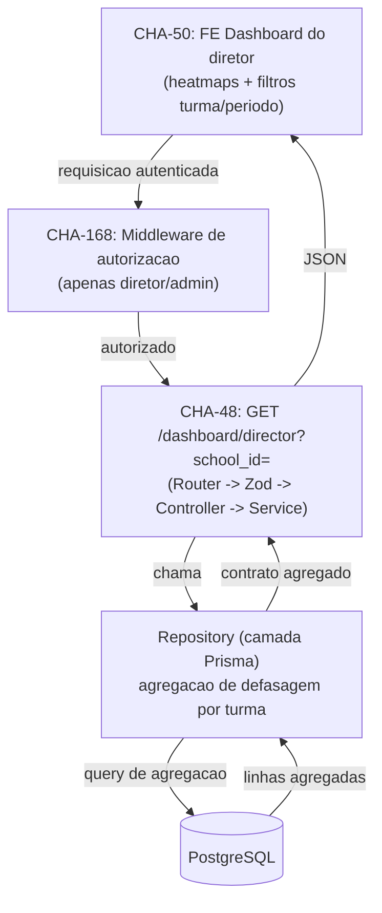

# Design Document: CHA-49 - Relacionamentos dos dados do dashboard do diretor

## Overview

Esta spec documenta a **estratégia de obtenção e modelagem dos dados** que alimentarão o dashboard do diretor (US-07 / CHA-47), no qual um diretor visualiza um panorama das defasagens por turma e por matéria para orientar a pedagogia.

O escopo desta spec é **exclusivamente de planejamento de dados**. Nenhuma implementação é entregue aqui: não há edição de `schema.prisma`, não há geração de migration, não há código de repositório/serviço. O documento serve de referência para a equipe decidir, antes de escrever código, quais tabelas e colunas serão usadas, como os relacionamentos se conectam e como a agregação da defasagem será calculada.

A implementação real (alteração de `apps/backend/prisma/schema.prisma` + migration Prisma) fica para a **task de implementação**, a ser alinhada com **joao.mancio (CHA-49)**, que está com a issue atribuída e In Progress, e com a **CHA-48** (endpoint `GET /dashboard/director`), para evitar conflito de migrations e divergência de modelagem. Este design apenas propõe a modelagem; não a aplica.

## Architecture

### Posição na arquitetura em camadas

O backend Revoada Digital segue o fluxo `Router → Zod → Controller → Service → Repository → PostgreSQL`, e o **Prisma é usado somente na camada `repositories/`**. Esta spec respeita essa fronteira: toda a lógica de agregação proposta aqui vive, quando implementada, dentro de um repositório, exposta ao service como um contrato de dados já agregado.



### Como os dados fluem

1. **CHA-168** garante que só diretor/admin alcance o endpoint (a distinção de "diretor" é de autorização, não de modelo de dados — ver Decisões).
2. **CHA-48** recebe o filtro de entrada `school_id` (query param), valida com Zod e delega ao service.
3. O **repositório** executa a query de agregação proposta nesta spec (caminho `StudentProfile → MockExam → Attempt → AttemptAnswer → Question`), agrupando por turma e por matéria/conceito.
4. O resultado agregado retorna ao service e, por fim, vira o JSON que a **CHA-50** usa para renderizar heatmaps e filtros.

Esta spec define os passos 3 e 4 no nível de dados; a implementação deles pertence à CHA-49 (schema) e CHA-48 (query/endpoint).

## Components and Interfaces

> Esta spec é de planejamento de dados; os componentes abaixo descrevem **onde** a lógica viverá quando implementada (CHA-49/CHA-48), não entregam código.

### Componente: Repositório de Dashboard (camada `repositories/`)

**Propósito:** encapsular a query de agregação de defasagem, único ponto onde o Prisma é usado.

**Interface proposta:**

```typescript
interface DashboardRepository {
  // Recebe o filtro de entrada (school_id) e devolve o agregado por turma.
  getDirectorDashboard(schoolId: string): Promise<DirectorDashboard>;
}
```

**Responsabilidades:**
- Executar o caminho de joins `StudentProfile → MockExam → Attempt → AttemptAnswer → Question`.
- Filtrar `Attempt.status = SUBMITTED` e `isCorrect != null`.
- Agrupar por turma e por matéria/conceito e calcular `gapRate`.
- Devolver o contrato `DirectorDashboard` (ver Contrato de saída sugerido).

### Componente: Service de Dashboard (camada `services/`)

**Propósito:** orquestrar a chamada ao repositório e aplicar regras não triviais de montagem (ex.: incluir turmas sem dados).

**Interface proposta:**

```typescript
interface DashboardService {
  getDirectorDashboard(schoolId: string): Promise<DirectorDashboard>;
}
```

**Responsabilidades:**
- Garantir que todas as turmas da escola apareçam, inclusive as sem tentativas submetidas.
- Não acessar Prisma diretamente (delega ao repositório).

> Router/Zod/Controller e a autorização (CHA-168) são responsabilidade da CHA-48 e da CHA-168, não desta spec.

## Data Models

> **Atenção:** os blocos abaixo são **proposta de modelagem**, não o schema aplicado. Eles NÃO devem ser copiados para `apps/backend/prisma/schema.prisma` nesta etapa. A aplicação (edição do schema + migration) ocorre na task de implementação, coordenada com joao.mancio (CHA-49) e CHA-48.

### Nova entidade: `SchoolClass` (turma)

Não existe hoje entidade de turma no schema, e não há issue dedicada a criá-la. Como o dashboard agrupa defasagens **por turma**, propõe-se a entidade `SchoolClass`, pertencente a uma `School`.

```prisma
model SchoolClass {
  id       String @id @default(uuid())
  name     String // ex.: "3º ano A"
  schoolId String
  school   School @relation(fields: [schoolId], references: [id], onDelete: Restrict)

  students StudentProfile[]

  createdAt DateTime @default(now())
  updatedAt DateTime @updatedAt

  @@index([schoolId])
  @@map("school_classes")
}
```

- `onDelete: Restrict` em `school` segue o padrão já usado por `StudentProfile.school` e `TeacherProfile.school` (uma escola não é apagada enquanto tiver turmas).
- `@@index([schoolId])` apoia a listagem de turmas por escola.

### Alteração proposta em `School`

A `School` ganha a relação inversa com as turmas (exigida pelo Prisma):

```prisma
model School {
  id          String @id @default(uuid())
  school_name String @unique
  school_city String

  students StudentProfile[]
  teachers TeacherProfile[]
  classes  SchoolClass[] // NOVO: relacao inversa com turmas

  @@map("schools")
}
```

### Alteração proposta em `StudentProfile`

O `StudentProfile` ganha o vínculo **opcional** com a turma. O campo é `nullable` de propósito, para que a migration seja **não destrutiva**: alunos já cadastrados (que não têm turma) continuam válidos, sem exigir backfill nem travar o deploy.

```prisma
model StudentProfile {
  id     String @id @default(uuid())
  points Int    @default(0)

  userId   String @unique
  user     User   @relation(fields: [userId], references: [id], onDelete: Cascade)
  schoolId String
  school   School @relation(fields: [schoolId], references: [id], onDelete: Restrict)

  classId String?      // NOVO: opcional/nullable (migration nao destrutiva)
  class   SchoolClass? @relation(fields: [classId], references: [id], onDelete: SetNull)

  mockExams MockExam[]

  @@index([schoolId]) // NOVO (avaliar): apoia filtro por escola
  @@index([classId])  // NOVO (avaliar): apoia agrupamento por turma
  @@map("student_profiles")
}
```

- **`onDelete: SetNull`** (recomendado) em `class`: ao remover uma turma, os alunos não são bloqueados nem apagados — apenas ficam sem turma (`classId = null`). Isso evita que a remoção de uma turma trave por causa de alunos vinculados (o que aconteceria com `Restrict`). `SetNull` só é possível porque `classId` é nullable, e combina com a semântica de "aluno pode não ter turma".
- Os índices `schoolId` e `classId` são **sugestões a avaliar** (ver Índices), não obrigatórios.

### Entidades existentes reutilizadas (sem alteração)

A agregação reaproveita, sem mudanças, as entidades já existentes: `MockExam` (`studentId`, `@@index([studentId])`), `Attempt` (`mockExamId`, `status`, `@@index([mockExamId])`), `AttemptAnswer` (`attemptId`, `questionId`, `isCorrect`, `@@index([questionId])`) e `Question` (`subject`, `concept`, `@@index([subject, concept])`).

> **Observação sobre `Question.subject` / `Question.concept`:** ambos são `String` livres no schema atual (não o enum `Subjects`, que só é usado em `Forum.subject`). A agregação do dashboard agrupa por esses valores String como estão. Normalizar `Question.subject` para o enum `Subjects` seria uma mudança separada, fora do escopo desta spec.

### Índices

- **Reaproveitados:** `Question.@@index([subject, concept])` e `AttemptAnswer.@@index([questionId])` já suportam bem os joins e o agrupamento por matéria/conceito.
- **A avaliar (sem exagero):**
  - `StudentProfile.@@index([schoolId])` — apoia o filtro de entrada por `school_id` (CHA-48).
  - `StudentProfile.@@index([classId])` — apoia o agrupamento de saída por turma.
- Recomenda-se medir com `EXPLAIN` sobre dados reais antes de adicionar índices além destes, para não otimizar prematuramente (alinhado ao AGENTS.md).

## Estratégia de Agregação / Query

### Decisão: agregação em tempo real

A defasagem é calculada **em tempo real por query**, sem tabela ou view materializada. Isso evita otimização prematura e mantém os dados sempre consistentes com as tentativas mais recentes, alinhado à orientação do AGENTS.md de manter a mudança focada e não assumir decisões de infra que não foram pedidas. Se o volume crescer a ponto de a query ficar cara, a materialização pode ser reavaliada em issue própria.

### Caminho de joins

O filtro de entrada é `school_id`; o agrupamento de saída é por **turma + matéria/conceito**.

```
StudentProfile           (filtro: schoolId = :school_id; agrupar por classId)
      │  studentId
      ▼
MockExam                 (student -> exames do aluno)
      │  mockExamId
      ▼
Attempt                  (considerar APENAS status = 'SUBMITTED')
      │  attemptId
      ▼
AttemptAnswer            (isCorrect = true/false)
      │  questionId
      ▼
Question                 (subject, concept -> dimensao da defasagem)
```

### Métrica de defasagem

- **Defasagem = proporção de erros**: `erros / respondidas`, onde `respondidas` conta as `AttemptAnswer` com `isCorrect` não nulo (`true` ou `false`) e `erros` conta `isCorrect = false`.
- Equivalente: `taxa_de_acerto = acertos / respondidas` e `taxa_de_defasagem = 1 - taxa_de_acerto`.
- Considera-se **apenas** `Attempt.status = 'SUBMITTED'` (tentativas em andamento ou abandonadas não entram no panorama).
- Respostas com `isCorrect = null` (não respondidas/sem correção) são **excluídas do denominador**.
- Agregação por **turma** e, dentro dela, por **matéria (`subject`)** e opcionalmente por **conceito (`concept`)**.

### Exemplo ilustrativo — pseudo-SQL

> Ilustrativo, para comunicar a intenção. Os nomes de coluna usam os `@@map` reais (`student_profiles`, `mock_exams`, `attempts`, `attempt_answers`, `questions`).

```sql
SELECT
  sp.class_id                                  AS class_id,
  q.subject                                    AS subject,
  q.concept                                    AS concept,
  COUNT(*) FILTER (WHERE aa.is_correct IS NOT NULL)        AS answered,
  COUNT(*) FILTER (WHERE aa.is_correct = false)            AS wrong,
  COUNT(*) FILTER (WHERE aa.is_correct = true)             AS correct,
  -- taxa de defasagem = erros / respondidas (0 quando nao ha respondidas)
  CASE
    WHEN COUNT(*) FILTER (WHERE aa.is_correct IS NOT NULL) = 0 THEN 0
    ELSE COUNT(*) FILTER (WHERE aa.is_correct = false)::float
         / COUNT(*) FILTER (WHERE aa.is_correct IS NOT NULL)
  END                                           AS gap_rate
FROM student_profiles sp
JOIN mock_exams     me ON me.student_id = sp.id
JOIN attempts       a  ON a.mock_exam_id = me.id AND a.status = 'SUBMITTED'
JOIN attempt_answers aa ON aa.attempt_id = a.id
JOIN questions      q  ON q.id = aa.question_id
WHERE sp.school_id = :school_id
GROUP BY sp.class_id, q.subject, q.concept;
```

Nota: esse `JOIN` só traz turmas que tenham ao menos uma resposta submetida. Para que o dashboard liste **todas as turmas**, inclusive as sem dados, a implementação deve ou (a) buscar as turmas da escola separadamente e combinar com o agregado no service, ou (b) usar `LEFT JOIN` a partir de `school_classes`. A escolha fica para a task de implementação (ver Correctness Properties).

### Exemplo ilustrativo — Prisma (camada repositories)

Como o Prisma `groupBy` não cruza relações em um único passo, o caminho mais provável no repositório é uma query orientada a `AttemptAnswer` com `include`/`where` sobre as relações e agregação em memória, **ou** `prisma.$queryRaw` com o SQL acima. Esboço ilustrativo:

```typescript
// Ilustrativo - pertence a camada repositories/ na task de implementacao
const answers = await prisma.attemptAnswer.findMany({
  where: {
    isCorrect: { not: null },
    attempt: {
      status: "SUBMITTED",
      mockExam: { student: { schoolId } },
    },
  },
  select: {
    isCorrect: true,
    question: { select: { subject: true, concept: true } },
    attempt: {
      select: { mockExam: { select: { student: { select: { classId: true } } } } },
    },
  },
});
// Agrupar por (classId, subject, concept) e computar gap_rate em memoria,
// ou preferir $queryRaw com GROUP BY para empurrar a agregacao ao Postgres.
```

Para volumes maiores, `$queryRaw` com `GROUP BY` no Postgres tende a ser preferível à agregação em memória; a decisão final fica para a implementação.

## Contrato de saída sugerido

Shape agregado que o repositório devolveria ao service (a serialização final de API é responsabilidade da CHA-48). Serve para alinhar a fronteira repository → service.

```typescript
type SubjectGap = {
  subject: string;        // Question.subject (String livre no schema atual)
  concept: string | null; // Question.concept; null se agregado so por materia
  answered: number;       // respostas com isCorrect != null
  correct: number;
  wrong: number;
  gapRate: number;        // erros / respondidas, no intervalo [0, 1]; 0 se answered = 0
};

type ClassDashboard = {
  classId: string | null; // null = alunos sem turma
  className: string | null;
  totalAnswered: number;  // soma de answered no breakdown
  hasData: boolean;       // false quando a turma nao tem tentativas submetidas
  breakdown: SubjectGap[];
};

type DirectorDashboard = {
  schoolId: string;
  classes: ClassDashboard[];
};
```

- `classId: null` representa o grupo de alunos **sem turma** (possível porque `classId` é opcional).
- `hasData: false` / `breakdown: []` para turmas sem tentativas submetidas — a turma aparece no panorama, sem quebrar a agregação.

## Migrations e Riscos

Esta spec **não gera migration agora**. Registro das regras e riscos para a task de implementação:

- **Não destrutiva:** `classId` é nullable e `SchoolClass` é entidade nova; nenhum dado existente é alterado ou removido. Alunos já cadastrados permanecem válidos com `classId = null`.
- **Coordenação obrigatória:** a issue CHA-49 está atribuída a **joao.mancio** e a CHA-48 (endpoint) está In Progress com Maria Fernanda. Gerar uma migration a partir desta spec **criaria conflito** com o trabalho em andamento. A migration deve ser produzida **uma única vez**, por quem implementar a CHA-49, após alinhamento.
- **Migration imutável após merge:** uma vez mergeada, a migration não é editada; correções vêm em nova migration. Uma mudança atômica por migration.
- **Procedimento ao implementar:**
  1. Editar `schema.prisma` com `SchoolClass`, a relação `classes` em `School` e os campos `classId`/`class`/índices em `StudentProfile`.
  2. Gerar com `--create-only` para revisar o SQL antes de aplicar:
     `npx prisma migrate dev --create-only --name add_school_class_and_student_class` (executar em `apps/backend`, contra banco **local**).
  3. Revisar o SQL gerado (confirmar nullabilidade de `class_id`, `ON DELETE SET NULL`, criação de `school_classes` e índices).
  4. Aplicar localmente e validar com `npx prisma validate`.
- **Nunca** executar migration/seed/escrita contra banco de produção; confirmar que o destino é local antes de operar.

### Pontas soltas e riscos a sinalizar

- **Origem dos dados de turma:** não há issue para criar/popular turmas nem para atribuir alunos a turmas (CRUD de `SchoolClass` e vínculo `StudentProfile.classId`). Sem isso, `classId` será `null` para todos e o dashboard só terá o grupo "sem turma". É preciso uma task adicional para cadastro/atribuição de turmas.
- **`Question.subject` como String livre:** sem normalização, erros de digitação/variações ("Matemática" vs "MATH") fragmentam o agrupamento por matéria. Avaliar normalização em issue separada.
- **"Diretor" sem representação no modelo:** depende inteiramente da CHA-168 para restringir o acesso; o modelo de dados não distingue diretor de teacher/admin.
- **Período/filtros da CHA-50:** o filtro por período (ex.: `submittedAt` entre datas) não está nesta modelagem de relacionamentos; precisará ser incorporado à query na implementação da CHA-48, usando `Attempt.submittedAt`.

## Error Handling

> Cenários a tratar na implementação (CHA-48/CHA-49). Registrados aqui para orientar a task, não implementados nesta spec.

### Cenário 1: `school_id` ausente ou inválido

**Condição:** requisição sem `school_id` ou com formato inválido.
**Resposta:** validação na camada Zod (CHA-48) rejeita antes de chegar ao service, retornando erro de validação.
**Recuperação:** cliente reenvia com `school_id` válido.

### Cenário 2: Escola sem turmas ou sem tentativas submetidas

**Condição:** nenhuma turma cadastrada, ou turmas sem respostas em tentativas `SUBMITTED`.
**Resposta:** a agregação retorna `classes` possivelmente vazio, ou turmas com `hasData = false` e `breakdown: []`, sem erro.
**Recuperação:** não aplicável; é estado válido (ver Property 2).

### Cenário 3: Divisão por zero no cálculo da taxa

**Condição:** `answered = 0` ao calcular `gapRate`.
**Resposta:** a fórmula retorna `0` quando o denominador é zero (ver pseudo-SQL e Property 2), nunca lança erro aritmético.
**Recuperação:** não aplicável.

## Testing Strategy

Esta spec é **planejamento e não cria código**, portanto não há testes automatizados a entregar aqui.

- **Verificação desta spec:** revisão do design pela equipe (joao.mancio / CHA-48) e validação do schema **proposto** quando a implementação começar, via `npx prisma validate` e `npx prisma migrate dev --create-only` em ambiente **local**, revisando o SQL gerado.
- **Testes de agregação (pertencem à task de implementação):** o backend usa **vitest** (`npm test -w apps/backend`). Os testes da query de defasagem — taxa no intervalo `[0,1]`, exclusão de respostas `isCorrect = null`, consideração apenas de `SUBMITTED`, turma sem dados aparecendo como vazia — devem ser escritos junto do repositório/endpoint (CHA-49/CHA-48), não aqui.

## Correctness Properties

> As propriedades abaixo descrevem a lógica de agregação e servem de guia para os testes da task de implementação. **Não serão automatizadas nesta spec de planejamento.**

### Property 1: Taxa de defasagem limitada ao intervalo [0, 1]

Para qualquer conjunto de respostas submetidas de uma turma, a `gapRate` calculada (`erros / respondidas`) é sempre um número no intervalo fechado `[0, 1]`.

**Validates: Requirements 7.1, 7.2**

### Property 2: Turma sem tentativas submetidas não quebra a agregação

Para qualquer turma sem respostas submetidas (nenhuma `AttemptAnswer` com `isCorrect` não nulo em tentativas `SUBMITTED`), a agregação retorna a turma com `hasData = false`, `breakdown` vazio e `gapRate = 0`, sem erro de divisão por zero.

**Validates: Requirements 8.1, 8.2, 7.3**

### Property 3: Denominador ignora respostas sem correção

Para qualquer conjunto de respostas, o total `answered` conta somente `AttemptAnswer` com `isCorrect` não nulo; respostas com `isCorrect = null` não entram no denominador da `gapRate`.

**Validates: Requirements 6.1, 6.2**

### Property 4: Apenas tentativas SUBMITTED entram no cálculo

Para qualquer agregação, respostas vinculadas a tentativas com `status` diferente de `SUBMITTED` (ou seja, `IN_PROGRESS` ou `ABANDONED`) não influenciam `answered`, `correct`, `wrong` nem `gapRate`.

**Validates: Requirements 5.1, 5.2**

## Decisões e Trade-offs

### 1. Turma como entidade (`SchoolClass`) vs. agrupar só por escola

Optou-se por criar a entidade `SchoolClass`. O dashboard do diretor (US-07) exige panorama **por turma**; sem uma entidade de turma, só seria possível agrupar por escola, o que não atende ao requisito. Trade-off: introduz nova tabela e depende de um fluxo (ainda inexistente) para cadastrar turmas e vincular alunos.

### 2. Diretor via autorização (CHA-168) vs. novo valor no enum `ProfileType`

Decidiu-se **não** adicionar `DIRECTOR` ao `enum ProfileType`. O diretor é tratado como `TEACHER`/`ADMIN` vinculado à escola, e a distinção de acesso fica na camada de autorização (CHA-168), fora do modelo de dados. Trade-off: o modelo não "sabe" quem é diretor; a responsabilidade é inteiramente da autorização. Em troca, evita-se uma migration de enum e mudanças em cascata nos perfis.

### 3. Agregação em tempo real vs. materializada

Escolheu-se agregação **em tempo real** por query, sem view/tabela materializada. Mantém dados sempre atualizados e evita otimização prematura. Trade-off: custo por requisição cresce com o volume de tentativas; se necessário, a materialização entra como issue futura, suportada pelos índices já previstos.

### 4. `classId` opcional (nullable) vs. obrigatório

`StudentProfile.classId` é **opcional**. Garante migration não destrutiva (não quebra alunos existentes) e reflete a realidade de que um aluno pode ainda não ter turma. Trade-off: a agregação precisa tratar explicitamente o grupo "sem turma" (`classId = null`) e combinar `onDelete: SetNull` para não travar a remoção de turmas.
