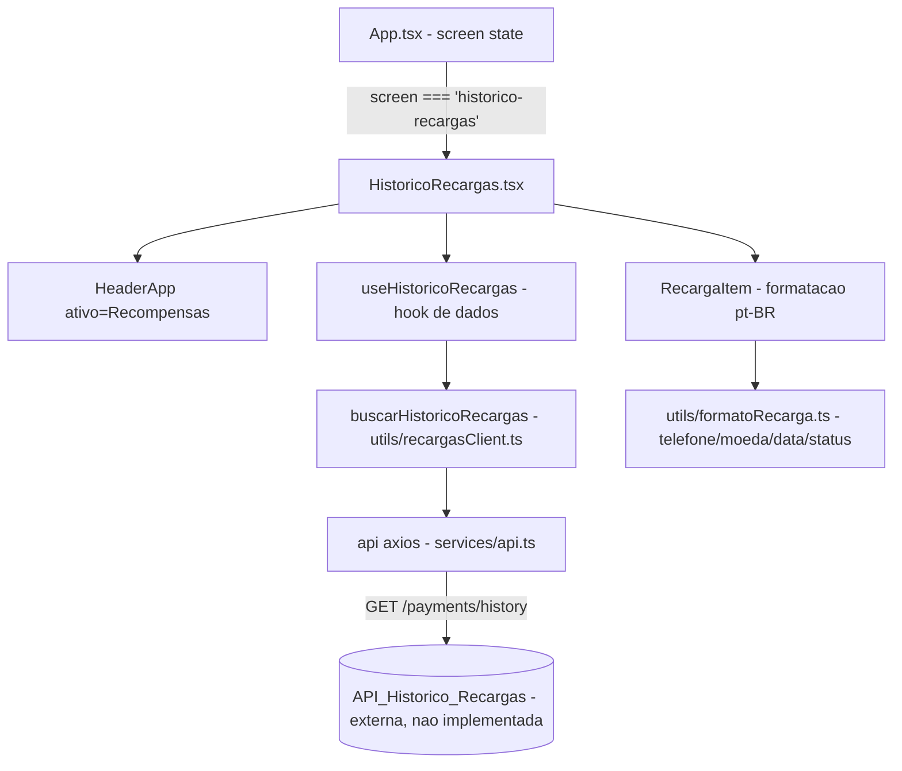

# Design Document

## Overview

Esta feature (CHA-196) entrega a tela de frontend **Tela_Historico** onde o aluno autenticado visualiza o histórico das recargas de celular que resgatou com seus pontos. O escopo é **exclusivamente frontend** (React + TypeScript + Vite, em `apps/frontend`). Nenhum trabalho de backend está incluído: o endpoint de histórico (**API_Historico_Recargas**) é tratado como **contrato/dependência externa ainda não implementada**.

A tela segue fielmente os padrões já presentes no pacote `apps/frontend`:

- Consome o cliente HTTP compartilhado `api` (axios) de `apps/frontend/src/services/api.ts`, que já injeta o token e trata `401` globalmente.
- Vive em `apps/frontend/src/pages/Recompensas/`, vizinha de `MeusResgates.tsx` e `CatalogoRecargas.tsx`.
- Usa Tailwind + o componente compartilhado `HeaderApp` (`ativo="Recompensas"`), igual a `MeusResgates.tsx`.
- Integra-se ao `App.tsx` por meio do estado `screen: Screen` (não há `react-router`), com callbacks de navegação por props.

### Objetivos e mapeamento aos Requisitos

| Objetivo | Requisitos |
| --- | --- |
| Carregar a primeira página ao montar, com estados loading/lista/vazio/erro | R1, R3, R4, R5 |
| Exibir os campos de cada recarga com formatação pt-BR e tratamento de ausência | R2 |
| Paginação incremental ("carregar mais") sem duplicar e preservando a ordem | R6 |
| Consumir a API via `api` axios, com contrato tipado e parâmetros de paginação | R7 |
| Preservar acessibilidade (landmarks, aria-live, teclado, estado desabilitado) | R8 |

### Decisão de escopo: contrato externo

O backend hoje expõe apenas `GET /payments/catalog` e `POST /payments/recharge`. O endpoint de histórico **não existe**. O design propõe o contrato esperado `GET /payments/history` paginado (ver [Contrato da API](#contrato-da-api_historico_recargas-dependência-externa)), mas deixa explícito que **o nome exato da rota e o shape da resposta devem ser confirmados com a tarefa de backend**. Enquanto o endpoint não existir, qualquer requisição falha e a tela cai no estado de erro (R7.5), sem quebrar a aplicação.

## Architecture

### Visão de componentes



### Camadas e responsabilidades

1. **`App.tsx`** — adiciona `'historico-recargas'` ao union `Screen` e um bloco de render condicional que exige usuário logado (padrão `if (!usuario) { setScreen('login'); return null }`), passando os callbacks de navegação. A entrada de navegação parte da área de recompensas (ver [Integração em App.tsx](#integração-em-apptsx)).
2. **`HistoricoRecargas.tsx`** (`pages/Recompensas/`) — página de apresentação. Renderiza `HeaderApp`, o cabeçalho/landmarks e deriva o que exibir a partir do estado do hook. Não faz I/O direto.
3. **`useHistoricoRecargas`** (`src/hooks/`) — hook de dados que encapsula estado, chamadas de página, acumulação de itens, deduplicação e a máquina de estados da UI. Segue o padrão de `useSaldoCoins.ts` (retorna um objeto `{ ..., carregando, erro, recarregar }` e usa a flag `ativo` para evitar atualização após desmontagem).
4. **`recargasClient`** (`src/utils/recargasClient.ts`) — função pura de I/O `buscarHistoricoRecargas(params)` que chama `api.get('/payments/history', { params, timeout })`. Espelha o padrão de `coinsClient.ts`/`attemptsClient.ts` (clientes tipados isolados em `utils`, com teste `*.test.ts` vizinho).
5. **`formatoRecarga`** (`src/utils/formatoRecarga.ts`) — funções puras de formatação pt-BR (data/hora, moeda BRL, telefone, rótulo de status) e de tratamento de campos ausentes. Puras e, portanto, alvo direto de property tests.

### Decisão: hook dedicado vs. lógica local

O `DashboardPage` mantém o I/O e os estados dentro da própria página com `useEffect`/`useState`; `useSaldoCoins` extrai a lógica para um hook reutilizável. Para esta tela escolho **hook dedicado `useHistoricoRecargas`** porque a paginação incremental introduz estado não trivial (acumulação, deduplicação, dois modos de erro, página atual a repetir). Extrair isso para um hook:

- mantém a página focada em apresentação/acessibilidade;
- torna a lógica de paginação testável de forma isolada (inclusive por property tests sobre a redução de páginas);
- segue a convenção já estabelecida por `useSaldoCoins` no mesmo diretório.

A formatação e a redução de páginas (merge + dedupe) ficam em funções puras em `utils`, chamadas pelo hook, para serem testáveis sem renderizar a árvore React.

## Components and Interfaces

### `recargasClient.ts` (`src/utils`)

```ts
import { api } from '../services/api';
import type { RespostaHistoricoRecargas, ParametrosPaginacao } from '../types/recargas.types';

/** Tempo limite por requisição (R1.2, R5.1, R6.6): 10 segundos. */
export const TIMEOUT_HISTORICO_MS = 10_000;

/**
 * Busca uma Pagina_Recargas da API_Historico_Recargas via Cliente_API.
 * O 401 e tratado globalmente pelo interceptor de `api` (R5.5, R7) — este
 * cliente nao o intercepta. Rejeita em timeout/erros !== 401.
 */
export async function buscarHistoricoRecargas(
  params: ParametrosPaginacao,
): Promise<RespostaHistoricoRecargas> {
  const { data } = await api.get<RespostaHistoricoRecargas>('/payments/history', {
    params, // { page, pageSize }
    timeout: TIMEOUT_HISTORICO_MS,
  });
  return data;
}
```

### Mock temporário de desenvolvimento (flag de dev)

Como a **API_Historico_Recargas** (`GET /payments/history`) ainda **não existe** no backend e o escopo permanece **somente frontend**, o cliente ganha um **mock temporário controlado por flag de desenvolvimento**. Isso permite validar visualmente loading, paginação incremental, lista vazia, dedupe e (opcionalmente) o estado de erro sem depender do endpoint real. É **código temporário de desenvolvimento**, claramente marcado, e **desligado por padrão** — produção e integração usam o endpoint real.

**Flag via `import.meta.env` (padrão Vite).** O pacote `apps/frontend` é Vite e já lê variáveis por `import.meta.env` (ex.: `VITE_API_URL`, `VITE_SOCKET_URL`). O mock segue a mesma convenção:

- `VITE_RECARGAS_HISTORICO_MOCK === 'true'` → liga o mock (default **desligado**: ausente/qualquer outro valor usa a API real).
- `VITE_RECARGAS_HISTORICO_MOCK_ERRO` (opcional) → quando `'true'`, faz o mock **rejeitar** (simulando erro/timeout) para exercitar o estado de erro de R5. Default desligado.

**Isolamento.** O mock vive isolado em `src/utils/recargasHistoricoMock.ts` e é importado **apenas** por `recargasClient`. Nenhum outro módulo (página, hook, tipos) o conhece.

```ts
// src/utils/recargasHistoricoMock.ts
// CÓDIGO TEMPORÁRIO DE DESENVOLVIMENTO — remover/desligar na integração
// com a API_Historico_Recargas real. Ligado apenas via flag de dev.
import type { RespostaHistoricoRecargas, ParametrosPaginacao } from '../types/recargas.types';

/** Atraso simulado para exercitar o estado de carregamento (R1.2, R3.1). */
const LATENCIA_MOCK_MS = 600;

/**
 * Retorna uma Pagina_Recargas fake com EXATAMENTE o shape de
 * RespostaHistoricoRecargas, respeitando page/pageSize e derivando `hasMore`
 * de um total fixo de itens fake. Permite múltiplas páginas, próxima página
 * vazia e (via flag de erro) rejeição para validar o estado de erro.
 * NÃO simula 401 (delegado ao interceptor global de `api`).
 */
export async function buscarHistoricoRecargasMock(
  params: ParametrosPaginacao,
): Promise<RespostaHistoricoRecargas>;
```

Comportamento do mock:

- **Mesmo shape:** devolve `{ items: Recarga[], page, pageSize, hasMore }`, idêntico ao contrato proposto, para que o hook e a página não percebam diferença.
- **Paginação real sobre dados fake:** mantém um conjunto fixo de Recargas fake (ordenado decrescente por `createdAt`), fatia por `page`/`pageSize` e calcula `hasMore` comparando com o total — exercitando várias páginas, dedupe por `id` e **próxima página vazia** (`items: []`, `hasMore: false`). Um total configurado como `0` reproduz a **lista vazia** (R4).
- **Latência simulada:** resolve após `LATENCIA_MOCK_MS` para tornar visível o loading inicial e o "carregando mais".
- **Erro opcional:** com `VITE_RECARGAS_HISTORICO_MOCK_ERRO === 'true'`, rejeita após a latência (sem status 401), para validar `erro-inicial`/`erro-carregar-mais`. **Não** simula 401, que é responsabilidade do interceptor global de **Cliente_API**.

Integração no `recargasClient` — o branch da flag é o único ponto que muda no cliente:

```ts
export async function buscarHistoricoRecargas(
  params: ParametrosPaginacao,
): Promise<RespostaHistoricoRecargas> {
  // Branch TEMPORÁRIO de desenvolvimento (flag desligada por padrão).
  if (import.meta.env.VITE_RECARGAS_HISTORICO_MOCK === 'true') {
    return buscarHistoricoRecargasMock(params);
  }
  const { data } = await api.get<RespostaHistoricoRecargas>('/payments/history', {
    params,
    timeout: TIMEOUT_HISTORICO_MS,
  });
  return data;
}
```

**Caminho de remoção/desligamento na integração.** Quando a API_Historico_Recargas real existir, basta **manter a flag desligada** (o default) ou **remover** `recargasHistoricoMock.ts` junto com o branch condicional em `recargasClient`. A **página**, o **hook** (`useHistoricoRecargas`) e os **tipos** (`Recarga`, `RespostaHistoricoRecargas`) **não mudam** — o mock está contido exclusivamente no cliente.

### `useHistoricoRecargas` (`src/hooks`)

Interface de retorno (consumida pela página):

```ts
type EstadoUIHistorico =
  | 'carregando-inicial'   // R1.2, R3.1
  | 'lista'                // R1.3
  | 'vazio'                // R1.4, R4
  | 'erro-inicial'         // R1.5, R5
  | 'carregando-mais'      // R6.4
  | 'erro-carregar-mais';  // R6.6

interface RetornoHistoricoRecargas {
  estado: EstadoUIHistorico;
  recargas: Recarga[];          // itens acumulados, ordem decrescente por createdAt
  temMais: boolean;             // controla visibilidade de "carregar mais" (R6.1, R6.5)
  carregandoMais: boolean;      // desabilita o controle enquanto pendente (R6.4)
  recarregarInicial: () => void; // retry da primeira pagina (R5.3)
  carregarMais: () => void;      // proxima pagina (R6.2) e retry da mesma pagina falha (R6.6)
}

export function useHistoricoRecargas(): RetornoHistoricoRecargas;
```

Comportamento-chave:

- **Montagem**: dispara a página 1 com `pageSize = 20`, ordenação esperada decrescente por `createdAt` (R1.1, R7.3).
- **Acumulação e dedupe**: ao receber a próxima página, concatena após os itens existentes removendo `id` já presentes, preservando a ordem recebida (R6.3).
- **Dois modos de erro**: erro na primeira página → `erro-inicial` (R5); erro ao carregar mais → `erro-carregar-mais`, **mantendo os itens já exibidos** (R6.6). Guarda a última página solicitada para permitir repetir a mesma requisição.
- **401**: não é tratado aqui; o interceptor global de `api` remove o token e redireciona ao login (R5.5, R7.7).

### `HistoricoRecargas.tsx` (`pages/Recompensas`)

Props (mesmo conjunto de navegação de `MeusResgates`):

```ts
type Props = {
  userName?: string;
  onVoltar?: () => void;      // volta para 'recompensas'
  onInicio?: () => void;
  onDisciplinas?: () => void;
  onSimulados?: () => void;
  onComunidade?: () => void;
  onChat?: () => void;
  onPerfil?: () => void;
  onConfiguracoes?: () => void;
  onLogout?: () => void;
};
```

Renderização (derivada de `estado`):

- `HeaderApp` com `ativo="Recompensas"` (landmark `banner`, R8.1).
- `<main>` único (landmark `main`, R8.1) com título e subtítulo no padrão de `MeusResgates`.
- Região `aria-live="polite"` (`role="status"`/`role="alert"`) para anunciar loading/erro (R8.2).
- Lista semântica `<ul>` de `RecargaItem` (R8.1); cada item exibe os campos de R2.
- Controle "Carregar mais" (`<button type="button">`) visível só quando `temMais`, desabilitado enquanto `carregandoMais` (R6.1, R6.4, R6.5, R8.3, R8.5).
- Controle "Tentar novamente" nos estados de erro (R5.2, R6.6, R8.3).

### `formatoRecarga.ts` (`src/utils`)

Funções puras de apresentação:

```ts
/** DD/MM/AAAA HH:MM (24h), pt-BR (R2.1). '—' se ausente/invalida. */
export function formatarDataHora(iso: string | null | undefined): string;

/** "R$ 1.234,56" via Intl.NumberFormat('pt-BR', { style:'currency', currency:'BRL' }) (R2.2). */
export function formatarBRL(valor: number | null | undefined): string;

/** "(DD) NNNNN-NNNN" (R2.5). Mantem valor cru se nao casar o padrao esperado. */
export function formatarTelefone(numero: string | null | undefined): string;

/** Rotulo pt-BR de Status_Recarga; "Status desconhecido" p/ valor nao mapeado (R2.4, R2.7). */
export function rotuloStatus(status: string | null | undefined): string;

/** Indicador textual de dado indisponivel (R2.6). */
export const DADO_INDISPONIVEL = 'Indisponível';
```

Mapa de rótulos de status (R2.4): `PENDING → "Pendente"`, `COMPLETED → "Concluída"`, `REFUNDED → "Estornada"`. Qualquer outro valor → `"Status desconhecido"` (R2.7).

### Integração em App.tsx

1. Adicionar `'historico-recargas'` ao union `type Screen`.
2. Adicionar bloco de render condicional seguindo o padrão das telas logadas:

```tsx
if (screen === 'historico-recargas') {
  if (!usuario) { setScreen('login'); return null }
  return (
    <HistoricoRecargas
      userName={usuario.full_name}
      onVoltar={() => setScreen('recompensas')}
      onInicio={() => setScreen('dashboard')}
      onDisciplinas={() => setScreen('disciplinas')}
      onSimulados={() => setScreen('gerar-simulado')}
      onComunidade={() => setScreen('comunidade')}
      onChat={() => setScreen('chat')}
      onPerfil={menuProps.onPerfil}
      onConfiguracoes={menuProps.onConfiguracoes}
      onLogout={menuProps.onLogout}
    />
  )
}
```

3. **Ponto de entrada da navegação**: a tela é alcançada a partir da área de recompensas (ex.: um botão "Histórico de recargas" em `LojaRecompensas`/`CatalogoRecargas`), passando `() => setScreen('historico-recargas')`. O design **não** assume rota de URL — a navegação é por estado, como no restante do app. A fiação exata do botão de origem é detalhada na fase de tasks.

## Data Models

Tipos propostos em `apps/frontend/src/types/recargas.types.ts` (convenção `*.types.ts`, interfaces exportadas com comentários referenciando requisitos, como em `dashboard.types.ts`/`attempts.types.ts`).

```ts
/** Valores de Status_Recarga definidos no glossario (R7.5). */
export type StatusRecarga = 'PENDING' | 'COMPLETED' | 'REFUNDED';

/**
 * Uma Recarga retornada pela API_Historico_Recargas (R7.4, R7.5).
 * NOTA (ponta solta): `catalogItemName` deriva de RechargeCatalogItem.name;
 * o Payment do backend guarda apenas catalogItemId, entao o backend precisara
 * incluir/join o nome na resposta do historico.
 */
export interface Recarga {
  id: string;                 // identificador unico (dedupe de paginacao — R6.3)
  catalogItemName: string;    // nome do item de catalogo (R2.2)
  amountBRL: number;          // valor em BRL, 0,01..999999999,99 (R2.2, R7.5)
  coinsSpent: number;         // pontos gastos, inteiro >= 0 (R2.3, R7.5)
  status: StatusRecarga;      // R2.4, R7.5
  phoneNumber: string;        // telefone recarregado (R2.5)
  createdAt: string;          // ISO 8601 (R2.1, R7.5)
}

/** Parametros de paginacao enviados a API (R7.2, R7.3). */
export interface ParametrosPaginacao {
  page: number;      // inteiro >= 1, default 1
  pageSize: number;  // inteiro 1..50, default 20
}

export const PAGINA_INICIAL = 1;          // R7.3
export const TAMANHO_PAGINA_PADRAO = 20;  // R1.1, R7.3

/** Resposta paginada da API_Historico_Recargas (shape proposto, a confirmar). */
export interface RespostaHistoricoRecargas {
  items: Recarga[];
  page: number;
  pageSize: number;
  hasMore: boolean;  // indica existencia de mais itens (R6.1, R6.5)
}
```

> O shape acima é **proposto** e deliberadamente simples para facilitar ajuste quando o backend confirmar o contrato. Se o backend adotar outra forma (ex.: `total`/`totalPages` em vez de `hasMore`), apenas `recargasClient` e o mapeamento no hook precisam mudar; a página e os tipos de domínio (`Recarga`) permanecem estáveis.

### Contrato da API_Historico_Recargas (dependência externa)

- **Rota (proposta, a confirmar):** `GET /payments/history`
- **Autenticação:** via `Cliente_API` (`Authorization: Bearer <authToken>`); o aluno é resolvido pelo `userId` do token (R7.1).
- **Query params:** `page` (inteiro ≥ 1, default 1), `pageSize` (inteiro 1..50, default 20) (R7.2, R7.3).
- **Ordenação:** `createdAt` decrescente, mais recentes primeiro (R1.1).
- **Resposta (proposta):** objeto paginado `{ items: Recarga[], page, pageSize, hasMore }`.
- **Cada item** expõe: `id`, `catalogItemName` (derivado de `RechargeCatalogItem.name` — exige join/include no backend), `amountBRL`, `coinsSpent`, `status`, `phoneNumber`, `createdAt` (R7.4).

Enquanto o endpoint não existir, a requisição falha (ex.: `404`/erro de rede) e a tela entra no estado de erro de R5 (R7.7). O `401` é exceção: delegado ao interceptor global (R5.5).

## Correctness Properties

*Uma propriedade é uma característica ou comportamento que deve valer para todas as execuções válidas do sistema — uma afirmação formal sobre o que o sistema deve fazer. As propriedades funcionam como ponte entre a especificação legível por humanos e garantias de correção verificáveis por máquina.*

PBT **aplica-se parcialmente** a esta feature. A renderização, os landmarks de acessibilidade e os fluxos concretos de carregamento/retry são cobertos por testes de componente baseados em exemplos (Testing Library) — para isso PBT não agrega valor. Em contrapartida, a **lógica pura** vale PBT: acumulação/deduplicação de páginas, invariantes da máquina de estados e as funções de formatação pt-BR, todas com propriedades universais sobre um espaço de entrada amplo. As propriedades abaixo cobrem essa lógica pura.

As propriedades incidem sobre funções puras extraídas em `utils` (redução de páginas em `recargasClient`/helper de paginação e formatadores em `formatoRecarga.ts`) e sobre o reducer de estado do hook, exercitado sem renderizar a árvore React.

### Property 1: Acumulação de páginas preserva ordem e não duplica

*Para qualquer* sequência de Pagina_Recargas recebidas, o conjunto acumulado de recargas exibidas deve ser a concatenação das páginas na ordem de recebimento, removendo recargas cujo `id` já esteja presente, sem reordenar os itens restantes.

**Validates: Requirements 1.3, 6.3**

### Property 2: Visibilidade do controle "carregar mais"

*Para qualquer* Pagina_Recargas recebida, o controle de carregar mais itens deve estar visível se e somente se a resposta indicar que existem mais Recargas (`hasMore` verdadeiro); quando não houver mais itens (inclusive na lista vazia ou em próxima página vazia), o controle deve estar oculto.

**Validates: Requirements 4.2, 6.1, 6.5**

### Property 3: Exclusividade dos estados de UI

*Para qualquer* estado da Tela_Historico, no máximo um entre `vazio`, `erro-inicial` e `lista` vale ao mesmo tempo; e sempre que o estado for `vazio` ou `erro-inicial`, a lista de recargas exibidas deve estar vazia (sem dados parciais).

**Validates: Requirements 4.3, 4.4, 5.1**

### Property 4: Erro ao carregar mais preserva os itens exibidos

*Para qualquer* lista de recargas já acumulada, quando uma requisição de próxima Pagina_Recargas falha (erro diferente de 401 ou timeout), a lista de recargas exibidas após o erro deve ser idêntica à lista exibida imediatamente antes da requisição.

**Validates: Requirements 6.6**

### Property 5: Totalidade do rótulo de status

*Para qualquer* valor de status, `rotuloStatus` deve retornar um rótulo pt-BR não vazio; se o status pertencer a {PENDING, COMPLETED, REFUNDED}, o rótulo deve ser o rótulo conhecido correspondente; caso contrário, deve ser exatamente o rótulo de status desconhecido.

**Validates: Requirements 2.4, 2.7**

### Property 6: Formatação de data e hora pt-BR

*Para qualquer* data e hora válida em ISO 8601, `formatarDataHora` deve produzir uma string no padrão `DD/MM/AAAA HH:MM` (24 horas, pt-BR).

**Validates: Requirements 2.1**

### Property 7: Formatação de valor em BRL

*Para qualquer* valor decimal no intervalo 0,01..999999999,99, `formatarBRL` deve produzir uma string iniciada por "R$", com exatamente duas casas decimais, vírgula como separador decimal e ponto como separador de milhar (pt-BR).

**Validates: Requirements 2.2**

### Property 8: Formatação de telefone pt-BR

*Para qualquer* sequência de 11 dígitos, `formatarTelefone` deve produzir uma string no padrão `(DD) NNNNN-NNNN`.

**Validates: Requirements 2.5**

### Property 9: Indicador de dado indisponível por campo ausente

*Para qualquer* Recarga em que um único campo exibível esteja ausente ou nulo, a exibição desse campo deve apresentar o indicador de dado indisponível, enquanto os demais campos permanecem com seus valores formatados normalmente.

**Validates: Requirements 2.6**

## Error Handling

- **Timeout de 10 segundos (R1.2, R1.5, R5.1, R6.6):** configurado por requisição em `recargasClient` via `timeout: TIMEOUT_HISTORICO_MS` do axios. O axios rejeita com `code === 'ECONNABORTED'` ao estourar; o hook trata essa rejeição como erro de carregamento (igual a qualquer erro de status ≠ 401).
- **Erro na primeira página (R5):** o hook entra em `erro-inicial`, não exibe dados parciais e expõe `recarregarInicial`. A página renderiza a mensagem de erro e o botão "Tentar novamente" (acessível por teclado).
- **Erro ao carregar mais (R6.6):** o hook entra em `erro-carregar-mais` mantendo `recargas` intactas e memoriza a página falha; `carregarMais` repete exatamente a mesma página.
- **401 (R5.5, R7.7):** não é tratado na tela. O interceptor de resposta de `api` remove `authToken` e faz `window.location.href = '/login'`. O cliente e o hook deixam a rejeição propagar sem exibir a mensagem de erro de carregamento.
- **Endpoint inexistente (R7.7):** enquanto `GET /payments/history` não existir, a resposta será um erro (ex.: `404`), caindo no estado de erro de R5 sem encerrar a aplicação.
- **Mock de dev (flag):** com `VITE_RECARGAS_HISTORICO_MOCK === 'true'`, `buscarHistoricoRecargas` retorna dados fake e a tela exibe a lista em vez de cair no estado de erro de R7.7. Com a flag **desligada** (default) e sem o endpoint real, o comportamento permanece o de R7.7 (estado de erro). A variante opcional `VITE_RECARGAS_HISTORICO_MOCK_ERRO === 'true'` faz o mock rejeitar para exercitar propositalmente o estado de erro de R5 (sem simular 401).
- **Dados ausentes/inválidos por campo (R2.6, R2.7):** tratados de forma defensiva nos formatadores (`DADO_INDISPONIVEL`, "Status desconhecido"), de modo que um campo nulo nunca derruba a renderização do item.

## Testing Strategy

O pacote `apps/frontend` **tem** script de testes: `npm run test --workspace apps/frontend` (`vitest --run`), com `@testing-library/react`, `jsdom` (`src/test/setup.ts`) e `fast-check` já instalados. Há testes de componente de exemplo (`Dashboard.page.test.tsx`) e property tests (`derivadorMetricas.property.test.ts`). A estratégia reaproveita esses dois padrões.

### Testes de componente / unidade (exemplos, edge cases, acessibilidade)

Baseados em `Dashboard.page.test.tsx`: renderizar `HistoricoRecargas` com `recargasClient` (ou o módulo `api`) mockado via `vi.mock`/`vi.stubGlobal`, aguardando estados assíncronos com `findBy*`. Cobertura por exemplo:

- Carregamento inicial com `page=1`, `pageSize=20` (R1.1, R7.2, R7.3); indicador de loading enquanto pendente (R1.2, R3.1, R3.2).
- Lista com itens (R1.3); lista vazia (R1.4, R4.1); erro inicial com retry que recarrega (R1.5, R3.3, R5.1–R5.4, R7.7).
- Paginação: acionar "carregar mais" chama `page=2` (R6.2); loading/desabilitado durante a próxima página (R6.4); próxima página vazia mantém itens e oculta o controle (R6.7).
- 401 não exibe a mensagem de erro de carregamento (delegado ao interceptor) (R5.5) — teste de integração leve com o interceptor de `api`.
- Acessibilidade: um `banner`, um `main`, lista semântica (R8.1); região `aria-live="polite"` ao entrar em loading/erro (R8.2); botões focáveis/acionáveis por teclado com estado desabilitado exposto (R8.3, R8.4, R8.5).
- Exibição de campos e `coinsSpent` inteiro (R2.3); mapeamento de payload representativo para o tipo `Recarga` (R7.4).

Os testes **não dependem** do mock de dev: eles mockam `recargasClient`/`api` diretamente via `vi.mock` (sem ligar a flag `VITE_RECARGAS_HISTORICO_MOCK`), controlando respostas e erros de forma determinística. O mock de desenvolvimento fica restrito à **validação visual manual** da tela.

### Testes baseados em propriedades (fast-check)

Baseados em `derivadorMetricas.property.test.ts`. Cada propriedade de correção é implementada por **um único** property test com **mínimo de 100 iterações** e **tag** referenciando a propriedade do design.

- Biblioteca: `fast-check` (já presente) — não implementar PBT do zero.
- Configuração: `fc.assert(fc.property(...), { numRuns: 100 })` (ou superior).
- Formato da tag (comentário no teste): `// Feature: cha-196-historico-recargas, Property {n}: {texto da propriedade}`.

Mapa propriedade → alvo:

| Propriedade | Alvo de teste |
| --- | --- |
| P1 Acumulação de páginas | reducer puro de merge/dedupe de páginas |
| P2 Visibilidade "carregar mais" | derivação `temMais` a partir de `hasMore`/estado |
| P3 Exclusividade de estados | reducer de estado do hook |
| P4 Erro ao carregar mais preserva itens | reducer de estado do hook |
| P5 Totalidade do rótulo de status | `rotuloStatus` |
| P6 Data/hora pt-BR | `formatarDataHora` |
| P7 Moeda BRL | `formatarBRL` |
| P8 Telefone pt-BR | `formatarTelefone` |
| P9 Dado indisponível por campo | helper de exibição de campo / `RecargaItem` |

Os geradores respeitam os domínios do contrato (R7.5): `amountBRL` em 0,01..999999999,99, `coinsSpent` inteiro ≥ 0, `status` no enum (mais valores arbitrários para exercitar R2.7), `createdAt` em ISO 8601.

### Validação adicional

- Lint: `npm run lint --workspace apps/frontend`
- Build/type-check: `npm run build --workspace apps/frontend` (`tsc -b && vite build`)

## Riscos e pontas soltas

- **Dependência de endpoint inexistente:** `GET /payments/history` ainda não existe no backend. Até ser criado, a tela sempre exibirá o estado de erro (R7.7). Nome da rota e shape da resposta devem ser confirmados com a tarefa de backend.
- **Nome do item via join:** o modelo `Payment` guarda apenas `catalogItemId`. O backend precisará incluir/join `RechargeCatalogItem.name` para preencher `catalogItemName`; caso contrário, o front cairá no tratamento de dado indisponível (R2.6) para o nome.
- **Divergência legada em `CatalogoRecargas.tsx`:** usa `fetch` direto, rotas `/recharges/...` e tokens `token`/`accessToken`, além de CSS co-localizado. É um padrão **legado divergente** e **não** deve ser replicado. A tela nova usa `api` (axios), o prefixo real `/payments` e Tailwind + `HeaderApp`.
- **Shape do contrato pode mudar:** o formato paginado proposto (`items`/`hasMore`) é uma suposição; se o backend adotar `total`/`totalPages`, apenas `recargasClient` e o mapeamento no hook mudam, isolando a página e o tipo `Recarga`.
- **Ponto de entrada de navegação:** o botão de origem (na área de recompensas) e sua fiação exata são definidos na fase de tasks; o design não assume rota de URL.
- **Mock de desenvolvimento (flag):** o mock em `recargasHistoricoMock.ts` é **temporário** e controlado por `VITE_RECARGAS_HISTORICO_MOCK`, **desligado por padrão**. Deve ser conferido/removido na integração para **não mascarar** a ausência do endpoint real (R7.7); enquanto ligado, a tela não chega a bater na API_Historico_Recargas. O shape dos dados fake deve **acompanhar** qualquer mudança no contrato confirmado pelo backend, para que o mock não divirja da `RespostaHistoricoRecargas` real.
