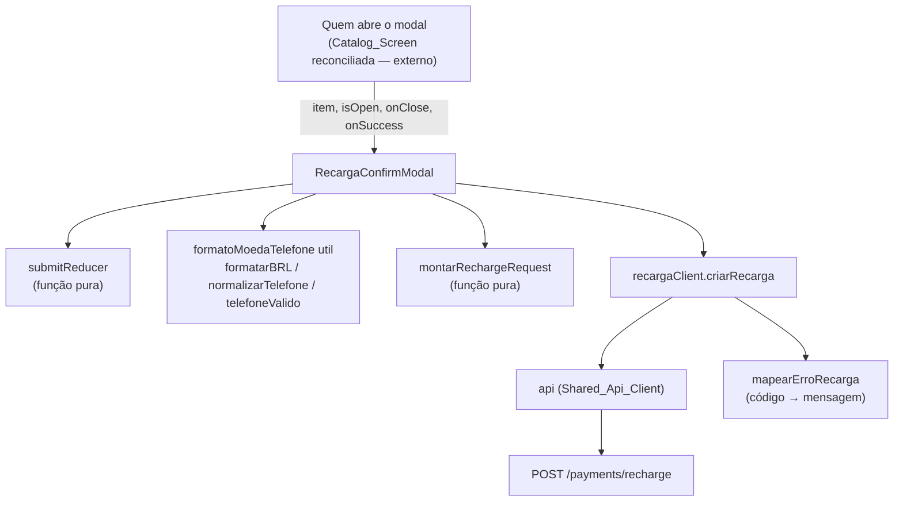

# Design Document: Modal de Confirmação de Recarga (CHA-62)

## Overview

Esta feature adiciona um modal de confirmação de recarga no frontend (`apps/frontend`). O modal recebe um Catalog_Item (no formato real do backend), exibe seus dados, coleta e valida o número de telefone, exige confirmação explícita e dispara a recarga via `POST /payments/recharge`, refletindo os estados de envio (idle, submitting, success, error) com possibilidade de nova tentativa.

O escopo é **exclusivamente frontend**. O backend já expõe `POST /payments/recharge` e `GET /payments/catalog`; nenhuma mudança de backend ocorre aqui.

Decisões de escopo fechadas com a usuária (ver `requirements.md`, seção "Premissas, limitações e riscos"):

- **Q1 — submit incluído.** O modal dispara a recarga por um Recharge_Service fino sobre o Shared_Api_Client (`services/api.ts`).
- **Q2 — catálogo fora de escopo.** O modal **não** busca o catálogo; recebe o Catalog_Item por props no formato real (`id`, `name`, `amountBRL`, `coinsCost`). Reconciliar a `CatalogoRecargas.tsx` (que ainda usa mock incompatível) é dependência externa.
- **Q3 — Phone_Field inicia vazio.**
- **Q4 — falha de provedor = erro genérico + retry**, sem aviso UNCERTAIN (o backend não expõe a distinção).
- **Q5 — componente de modal novo e acessível**, sem estender nem quebrar o `ConfirmDialog` atual.
- **Q6 — util de formatação próprio nesta branch** (BRL e telefone), com dívida de duplicação a reconciliar quando CHA-196 convergir na `develop`.

### Inspeção do código existente (base das decisões de estrutura)

- **`components/ConfirmDialog.tsx`**: overlay simples controlado por `isOpen`, dois botões, rótulo de progresso fixo `"Excluindo..."`. **Não** tem `role="dialog"`, focus trap, fechamento por Esc nem campo de entrada. Seus testes (`ConfirmDialog.test.tsx`) cobrem esse contrato atual. Por isso o Recharge_Modal é um componente **novo**, deixando o `ConfirmDialog` intocado.
- **`services/api.ts`**: cliente axios compartilhado com interceptor de request que injeta `authToken` e interceptor de response que trata 401 (remove token, redireciona para `/login`). O Recharge_Service reusa esse cliente e não monta headers.
- **`pages/Recompensas/CatalogoRecargas.tsx`**: hoje usa `fetch` manual, rotas inexistentes (`/recharges/catalog`, `/recharges/redeem`), tokens divergentes (`token`/`accessToken`), mock com formato incompatível e `catch` que finge sucesso. Esta feature **não** corrige essa tela (Q2); o novo modal e seus utils vivem ao lado, prontos para quando a tela for reconciliada.
- **`utils/coinsClient.ts`** e vizinhos: padrão de "client" fino em `utils` com uma função assíncrona e mensagem de erro de domínio. O Recharge_Service segue esse padrão, porém sobre o axios compartilhado (não `fetch`).

## Architecture



**Camadas já existentes (não alteradas):** `api` (`services/api.ts`) e seu interceptor global de 401; `ConfirmDialog` e seus testes.

**Camadas novas:**
- `utils/formatoMoedaTelefone.ts` — formatação de BRL e normalização/validação de telefone (funções puras).
- `utils/recargaClient.ts` — Recharge_Service fino (`criarRecarga`) e mapeamento de erro (`mapearErroRecarga`), sobre o `api` compartilhado.
- `utils/submitRecarga.ts` — reducer puro do Submit_State e `montarRechargeRequest`.
- `types/recarga.types.ts` — tipos `CatalogItem`, `RechargeRequest`, `SubmitState`, `SubmitAction`, `RecargaErroCodigo`.
- `components/RecargaConfirmModal.tsx` — o modal acessível novo que orquestra tudo.

A lógica pura (reducer, validação de telefone, montagem do request, formatação, mapeamento de erro) é separada do componente para permitir property tests (`fast-check`, já devDependency) e manter o componente focado em renderização e acessibilidade (RTL, já disponível).

## Sequence Diagrams

### Confirmação bem-sucedida

```mermaid
sequenceDiagram
    participant U as Usuário
    participant M as RecargaConfirmModal
    participant V as telefoneValido/normalizar
    participant R as submitReducer
    participant S as recargaClient
    participant A as api (POST /payments/recharge)

    U->>M: digita telefone e ativa Confirm_Control
    M->>V: normalizarTelefone(input) + telefoneValido
    alt telefone inválido
        M-->>U: mensagem de validação; não invoca serviço
    else telefone válido
        M->>R: dispatch(SUBMIT) => submitting
        M->>S: criarRecarga({catalogItemId, phoneNumber})
        S->>A: api.post('/payments/recharge', body)
        A-->>S: 201 Created
        S-->>M: ok
        M->>R: dispatch(SUCCESS) => success
        M-->>U: confirmação de sucesso
        M->>M: onSuccess()
    end
```

### Falha e nova tentativa

```mermaid
sequenceDiagram
    participant U as Usuário
    participant M as RecargaConfirmModal
    participant R as submitReducer
    participant S as recargaClient
    participant A as api

    M->>S: criarRecarga(body)
    S->>A: api.post('/payments/recharge', body)
    A-->>S: erro (401/404/409/502/500)
    S-->>M: RecargaError(codigo)
    M->>R: dispatch(ERROR, codigo) => error(mensagem)
    M-->>U: mensagem de erro não vazia; controles habilitados
    U->>M: ativa Confirm_Control de novo
    M->>R: dispatch(SUBMIT) => submitting (erro limpo)
    Note over A: 401 é tratado pelo interceptor global (redirect /login)
```

## Components and Interfaces

### Component 1: `formatoMoedaTelefone` util (puro)

**Purpose**: Formatar valores em BRL e normalizar/validar o telefone. Criado nesta branch (Q6).

**Interface**:
```typescript
// apps/frontend/src/utils/formatoMoedaTelefone.ts

/** Formata um valor em reais no padrão pt-BR (ex.: 15 -> "R$ 15,00"). */
export function formatarBRL(amountBRL: number): string;

/** Remove todos os caracteres não dígitos do texto digitado. */
export function normalizarTelefone(phoneValue: string): string;

/** true se o telefone normalizado casa com ^\d{2}9\d{8}$. */
export function telefoneValido(phoneValue: string): boolean;
```

**Responsibilities**:
- `formatarBRL`: usar `Intl.NumberFormat('pt-BR', { style: 'currency', currency: 'BRL' })`; função pura.
- `normalizarTelefone`: `phoneValue.replace(/\D/g, '')`.
- `telefoneValido`: `/^\d{2}9\d{8}$/.test(normalizarTelefone(phoneValue))`.

### Component 2: `recargaClient` (Recharge_Service fino)

**Purpose**: Enviar a recarga pelo Shared_Api_Client e traduzir falhas em código de domínio + mensagem.

**Interface**:
```typescript
// apps/frontend/src/utils/recargaClient.ts
import type { RechargeRequest, RecargaErroCodigo } from '../types/recarga.types';

export class RecargaError extends Error {
  constructor(public codigo: RecargaErroCodigo, message: string);
}

/** POST /payments/recharge via api compartilhado. Resolve em 201; lança RecargaError em falha. */
export function criarRecarga(request: RechargeRequest): Promise<void>;

/** Mapeia um código de erro de recarga para mensagem exibível (nunca vazia). */
export function mapearErroRecarga(codigo: RecargaErroCodigo): string;
```

**Responsibilities**:
- Usar `api.post('/payments/recharge', request)` — sem montar headers, sem ler `token`/`accessToken`; o interceptor injeta `authToken` e trata 401.
- Derivar `RecargaErroCodigo` a partir de `error.response?.status` e do `code` do corpo (`INSUFFICIENT_POINTS`, `PROVIDER_FAILURE`, etc.); 401 é repassado (o interceptor global cuida do redirect), resultando em estado de erro no modal sem mensagem de sucesso.
- `mapearErroRecarga`: retornar mensagem específica para `INSUFFICIENT_POINTS` (saldo insuficiente) e `PROVIDER_FAILURE` (falha genérica do provedor, com retry), e uma mensagem genérica para os demais. Nenhuma mensagem é vazia; nenhuma menciona UNCERTAIN.

### Component 3: `submitRecarga` (reducer puro + montagem do request)

**Purpose**: Modelar o Submit_State como máquina de estados determinística e montar o corpo da requisição.

**Interface**:
```typescript
// apps/frontend/src/utils/submitRecarga.ts
import type {
  CatalogItem, RechargeRequest, SubmitState, SubmitAction,
} from '../types/recarga.types';

export const estadoInicial: SubmitState; // { status: 'idle' }

/** Reducer puro e total do Submit_State. */
export function submitReducer(state: SubmitState, action: SubmitAction): SubmitState;

/** Monta o corpo estrito { catalogItemId, phoneNumber } a partir do item e do telefone digitado. */
export function montarRechargeRequest(item: CatalogItem, phoneValue: string): RechargeRequest;
```

**Responsibilities**:
- `submitReducer`: implementar a tabela de transições (ver Data Models). Ignorar `SUBMIT` enquanto `submitting` (sem efeito); ignorar `SUCCESS`/`ERROR` quando já em `success`; `SUBMIT` a partir de `error` limpa a mensagem e vai a `submitting`.
- `montarRechargeRequest`: retornar exatamente `{ catalogItemId: item.id, phoneNumber: normalizarTelefone(phoneValue) }`, sem campos legados.

### Component 4: `RecargaConfirmModal` (componente novo e acessível)

**Purpose**: Orquestrar exibição, coleta de telefone, confirmação/cancelamento, submit e acessibilidade.

**Interface**:
```typescript
// apps/frontend/src/components/RecargaConfirmModal.tsx
import type { CatalogItem } from '../types/recarga.types';

interface RecargaConfirmModalProps {
  isOpen: boolean;
  item: CatalogItem | null;     // dados a confirmar; null quando fechado
  onClose: () => void;          // cancelar/Esc/fechar sem efeito
  onSuccess?: (item: CatalogItem) => void; // notifica sucesso a quem abriu
}
```

**Responsibilities**:
- Renderizar `null` quando `!isOpen || !item` (R1.2).
- Exibir `name`, `formatarBRL(amountBRL)` e `coinsCost` como pontos (R2.1–R2.3), usando o formato real (R2.4).
- Phone_Field com `<label htmlFor>` associado, iniciando vazio (R3.1, R3.7); atualizar `phoneValue` controlado (R3.2).
- Ao confirmar: validar com `telefoneValido`; se inválido/obrigatório, exibir mensagem e não invocar serviço (R3.3, R3.4, R4.1); se válido, `dispatch(SUBMIT)`, chamar `criarRecarga(montarRechargeRequest(item, phoneValue))` (R3.5, R4.2, R4.5); limpar erro anterior ao reenviar (R7.6); remover a mensagem de validação quando o input passar a válido (R3.6).
- Refletir estados: `submitting` desabilita ambos os controles e troca o rótulo do confirmar por progresso (R5.1–R5.5); `success` exibe confirmação identificando a recarga (R6.1, R6.2); `error` mantém aberto com controles habilitados e mensagem não vazia, sem texto de sucesso/"simulado" (R7.1–R7.3, R7.7).
- Garantir idempotência de resultado: já consolidada no reducer (R6.3) e via guarda contra reenvio em `submitting` (R5.4).
- Acessibilidade: `role="dialog"` + `aria-modal="true"` + `aria-labelledby` para o título (R9.1); focus trap entre os controles (R9.2); foco inicial num elemento interno (R9.3, foco no Phone_Field); Esc fecha quando `status !== 'submitting'` (R4.4, R9.4); controles operáveis por teclado (R9.5); Cancel e fechar por Esc chamam `onClose` sem invocar o serviço (R4.3).

## Data Models

Novos tipos em `apps/frontend/src/types/recarga.types.ts`:

```typescript
export interface CatalogItem {
  id: string;        // uuid
  name: string;
  amountBRL: number; // valor em reais
  coinsCost: number; // pontos (inteiro)
}

export interface RechargeRequest {
  catalogItemId: string;
  phoneNumber: string; // telefone normalizado (11 dígitos)
}

export type RecargaErroCodigo =
  | 'UNAUTHORIZED'        // 401
  | 'NOT_FOUND'           // 404
  | 'INSUFFICIENT_POINTS' // 409
  | 'PROVIDER_FAILURE'    // 502
  | 'SERVER_ERROR'        // 500
  | 'UNKNOWN';            // demais

export type SubmitState =
  | { status: 'idle' }
  | { status: 'submitting' }
  | { status: 'success' }
  | { status: 'error'; codigo: RecargaErroCodigo; mensagem: string };

export type SubmitAction =
  | { type: 'SUBMIT' }
  | { type: 'SUCCESS' }
  | { type: 'ERROR'; codigo: RecargaErroCodigo; mensagem: string }
  | { type: 'RESET' };
```

### Tabela de transições do `submitReducer`

| Estado atual \ Ação | SUBMIT | SUCCESS | ERROR | RESET |
|---|---|---|---|---|
| `idle` | `submitting` | `idle` (ignora) | `idle` (ignora) | `idle` |
| `submitting` | `submitting` (ignora — guarda contra duplo envio, R5.4) | `success` | `error` | `idle` |
| `success` | `success` (ignora, R6.3) | `success` (ignora, R6.3) | `success` (ignora, R6.3) | `idle` |
| `error` | `submitting` (limpa erro, R7.6) | `error` (ignora) | `error` (atualiza código/mensagem) | `idle` |

O reducer é **total** (toda combinação estado×ação tem destino definido) e **determinístico**. `RESET` é usado ao fechar o modal para reinicializar.

### Phone_Rule

`Normalized_Phone` deve casar com `^\d{2}9\d{8}$` (DDD de 2 dígitos + `9` + 8 dígitos = 11 dígitos). `Normalized_Phone = phoneValue.replace(/\D/g, '')`.

## Correctness Properties

*Uma propriedade é uma característica ou comportamento que deve ser verdadeiro em todas as execuções válidas do sistema — uma afirmação formal sobre o que o sistema deve fazer. Propriedades são a ponte entre especificações legíveis por humanos e garantias de correção verificáveis por máquina.*

As propriedades abaixo cobrem a lógica pura extraída do componente. Estados/efeitos de UI (acessibilidade, habilitar/desabilitar botões, textos exibidos) são validados por testes de exemplo com React Testing Library (ver Testing Strategy), não por property tests.

### Property 1: Reducer de Submit_State é total, determinístico e idempotente onde exigido

Para todo `SubmitState` `s` e toda `SubmitAction` `a`, `submitReducer(s, a)` retorna um `SubmitState` válido definido pela tabela de transições; em particular: a partir de `submitting`, `SUBMIT` mantém `submitting` (sem iniciar novo envio); a partir de `success`, qualquer `SUBMIT`/`SUCCESS`/`ERROR` mantém `success`; a partir de `error`, `SUBMIT` transita para `submitting` sem preservar a mensagem de erro anterior.

**Validates: Requirements 5.1, 5.4, 6.1, 6.3, 7.1, 7.6**

### Property 2: Validação de telefone casa exatamente a Phone_Rule

Para toda string `p`, `telefoneValido(p) === true` se e somente se `p.replace(/\D/g, '')` casa com `^\d{2}9\d{8}$`. Em particular, strings vazias ou compostas apenas de não dígitos (incluindo espaços) resultam em `false`.

**Validates: Requirements 3.3, 3.4, 3.5**

### Property 3: Montagem do Recharge_Request é estrita e usa o telefone normalizado

Para todo `CatalogItem` `item` e toda string `p` com `telefoneValido(p)`, `montarRechargeRequest(item, p)` possui exatamente as chaves `catalogItemId` e `phoneNumber`, com `catalogItemId === item.id` e `phoneNumber === normalizarTelefone(p)`, e nunca inclui `userId`, `rechargeId`, `valor` ou `pontosGastos`.

**Validates: Requirements 1.3, 3.5, 4.2, 4.5**

### Property 4: Formatação BRL em pt-BR

Para todo número finito não negativo `v`, `formatarBRL(v)` equivale à saída de `Intl.NumberFormat('pt-BR', { style: 'currency', currency: 'BRL' }).format(v)`: contém o símbolo `R$`, usa vírgula como separador decimal e sempre duas casas decimais.

**Validates: Requirements 2.2**

### Property 5: Mensagem de erro nunca é vazia

Para todo `RecargaErroCodigo` `c`, `mapearErroRecarga(c)` retorna uma string não vazia (após `trim`), e nunca é uma mensagem que afirme sucesso.

**Validates: Requirements 7.3, 7.7**

## Error Handling

### Cenário 1: Telefone inválido ou vazio na confirmação
**Condition**: `telefoneValido(phoneValue) === false` ao ativar o Confirm_Control.
**Response**: exibe mensagem de validação (obrigatório quando vazio/só espaços; inválido caso contrário) e não invoca o Recharge_Service; `Submit_State` permanece `idle`.
**Recovery**: ao editar para um valor válido, a mensagem some (R3.6) e o confirmar volta a submeter.

### Cenário 2: HTTP 409 `INSUFFICIENT_POINTS`
**Condition**: backend responde 409 com `code: INSUFFICIENT_POINTS`.
**Response**: `dispatch(ERROR, 'INSUFFICIENT_POINTS')`; mensagem indica saldo de pontos insuficiente; modal aberto com controles habilitados.
**Recovery**: usuário pode cancelar ou tentar de novo.

### Cenário 3: HTTP 502 `PROVIDER_FAILURE`
**Condition**: backend responde 502 com `code: PROVIDER_FAILURE`.
**Response**: mensagem **genérica** de falha ao solicitar ao provedor, permitindo nova tentativa. Sem aviso específico de UNCERTAIN — o backend não distingue DEFINITIVE/UNCERTAIN ao cliente (ver risco R1 em requirements).
**Recovery**: nova tentativa pelo Confirm_Control (limpa o erro anterior, R7.6).

### Cenário 4: HTTP 401 durante o envio
**Condition**: backend responde 401.
**Response**: o interceptor global do `api` remove `authToken` e redireciona para `/login`. O modal não exibe confirmação de sucesso; o reducer vai a `error` (defensivo) caso a promessa rejeite antes do redirect.
**Recovery**: delegado ao fluxo de login global.

### Cenário 5: 404 / 500 / falha de rede
**Condition**: demais erros HTTP ou rejeição de rede.
**Response**: `dispatch(ERROR)` com código mapeado (`NOT_FOUND`, `SERVER_ERROR`, `UNKNOWN`) e mensagem genérica não vazia; nunca texto de sucesso/"simulado" (R7.7).
**Recovery**: nova tentativa ou cancelar.

### Cenário 6: Respostas de sucesso duplicadas
**Condition**: mais de um resultado de sucesso para a mesma ativação.
**Response**: o reducer ignora `SUCCESS` quando já em `success` (R6.3); a guarda de `submitting` impede novo envio (R5.4).
**Recovery**: N/A.

## Testing Strategy

### Abordagem geral
Abordagem dupla e complementar: **property tests** (`fast-check`) para a lógica pura e **testes de exemplo/componente** (Vitest + React Testing Library, ambientes `jsdom`) para UI, acessibilidade e wiring. Scripts: `npm run test --workspace apps/frontend` (vitest `--run`). O projeto não tem framework de teste adicional a instalar.

### Property-Based Testing (lógica pura)
Biblioteca: **fast-check** (já em devDependencies). Mínimo **100 iterações** por propriedade. Cada teste referencia a propriedade do design com tag no formato **Feature: cha-62-modal-confirmacao-recarga, Property {N}: {texto}**.

- **Property 1** (`submitRecarga.property.test.ts`): gerar sequências de `SubmitAction` a partir de `estadoInicial` e verificar totalidade/determinismo e as invariantes de idempotência e limpeza de erro da tabela.
- **Property 2** (`formatoMoedaTelefone.property.test.ts`): gerar strings arbitrárias e dígitos; verificar a equivalência de `telefoneValido` com a regex sobre o normalizado; gerador inclui whitespace e strings vazias (edge cases de R3.4).
- **Property 3** (`submitRecarga.property.test.ts`): gerar `CatalogItem` e telefones válidos; verificar chaves exatas, `catalogItemId === item.id` e `phoneNumber` normalizado.
- **Property 4** (`formatoMoedaTelefone.property.test.ts`): gerar números não negativos finitos; comparar `formatarBRL` com `Intl.NumberFormat` pt-BR (model-based).
- **Property 5** (`recargaClient.test.ts`): para cada `RecargaErroCodigo`, `mapearErroRecarga` não vazio e sem afirmação de sucesso.

### Unit / Component Testing (exemplos e edge cases)
- **`formatoMoedaTelefone`**: exemplos de `formatarBRL` (0, inteiros, centavos) e `normalizarTelefone` (com máscara/espaços).
- **`recargaClient`**: mockar o módulo `../services/api`; verificar `api.post('/payments/recharge', body)` (R8.1), que não lê `token`/`accessToken` nem monta headers (R8.2), e o mapeamento específico de `INSUFFICIENT_POINTS` (R7.4) e `PROVIDER_FAILURE` (R7.5).
- **`RecargaConfirmModal`** (RTL): render null quando fechado (R1.2); exibe dados reais do item (R2.1–R2.4); Phone_Field vazio e com label (R3.1, R3.7); edição atualiza valor e limpa validação (R3.2, R3.6); confirmar inválido/vazio exibe mensagem e não invoca serviço (R3.3, R3.4, R4.1); confirmar válido invoca o serviço uma única vez (R4.2); cancelar e Esc fecham sem invocar (R4.3, R4.4); `submitting` desabilita controles e mostra progresso, cliques repetidos não reenviam (R5.2–R5.5); sucesso mostra confirmação (R6.2); erro mantém aberto com controles habilitados e sem texto de sucesso/"simulado" (R7.2, R7.3, R7.7); 401 não mostra sucesso (R8.3).
- **Acessibilidade** (RTL + `@testing-library/user-event`): `role="dialog"` com nome acessível (R9.1); focus trap com `Tab`/`Shift+Tab` (R9.2); foco inicial interno (R9.3); Esc fecha fora de `submitting` e não fecha durante `submitting` (R9.4); label associado e botões por teclado (R9.5).

### Fora de escopo de teste
Integração real com backend e a reconciliação da `CatalogoRecargas.tsx` (dependência externa Q2/D1) não são testadas aqui; o modal é exercitado com `item` por props e `api` mockado.

## Dependencies

- **Runtime existente**: `react`, `axios` via `services/api.ts`. Nenhuma dependência de runtime nova.
- **Testes existentes**: `vitest`, `@testing-library/react`, `@testing-library/jest-dom`, `@testing-library/user-event` (dom), `fast-check`, `jsdom`. Nada a instalar.

## Suposições e dívidas (ver requirements)

1. **P1**: o Catalog_Item chega por props no formato real; o modal não busca o catálogo (Q2).
2. **D1**: reconciliar `CatalogoRecargas.tsx` ao `GET /payments/catalog` é externo; até lá o modal depende de quem o abre fornecer o formato correto.
3. **R1**: falha UNCERTAIN do provedor é indistinguível de DEFINITIVE para o cliente; a UI mostra erro genérico com retry (Q4).
4. **R2**: o util `formatoMoedaTelefone.ts` duplica a **lógica** de formatação de BRL e normalização/validação de telefone da CHA-196 (ainda não mergeada). O nome do arquivo foi escolhido para **evitar colisão de arquivo/merge** com o `formatoRecarga.ts` da CHA-196 quando as branches convergirem na `develop`; resta apenas a dívida de reconciliar a lógica duplicada numa única fonte (Q6).
