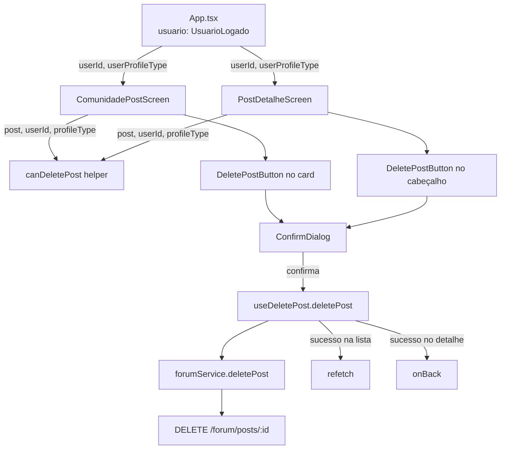
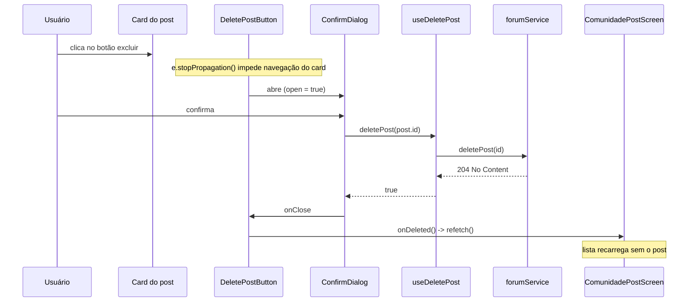
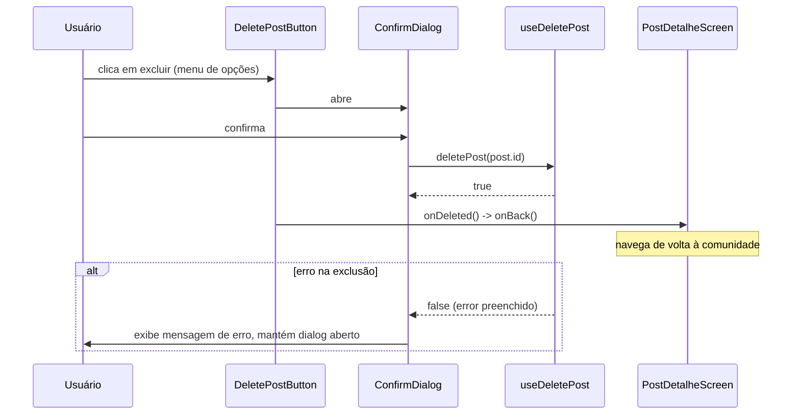

# Design Document: Delete Post Button

## Overview

Adiciona um botão de exclusão de post no fórum da comunidade, visível apenas para o autor do post ou para usuários com perfil de professor (`TEACHER`). O botão aparece em dois pontos de renderização: nos cards da lista (`ComunidadePostScreen`) e no cabeçalho do post no detalhe (`PostDetalheScreen`).

O escopo é **exclusivamente frontend**. A camada de serviço (`forumService.deletePost`), o hook (`useDeletePost`) e o endpoint `DELETE /forum/posts/:id` já existem e não são alterados. O trabalho consiste em (1) propagar o `profileType` do usuário logado do `App.tsx` até as duas telas, (2) centralizar a regra de permissão em um helper puro, (3) adicionar um componente de confirmação reutilizável e (4) integrar o botão nos dois pontos de renderização com confirmação, estado de carregamento, tratamento de erro e refresh/navegação após sucesso.

A decisão de UX é usar um modal de confirmação dedicado (`ConfirmDialog`) em vez de `window.confirm`, para manter consistência visual com o padrão de modal existente (`CreatePostModal`: overlay controlado por `isOpen`, estado de erro interno, botões estilizados com Tailwind).

## Architecture



**Camadas já existentes (não alteradas):** `forumService.deletePost`, `useDeletePost`, endpoint HTTP, tipos `ForumPost` / `ProfileType`.

**Camadas novas/alteradas:**
- `App.tsx` — propaga `userProfileType`.
- `utils/forumPermissions.ts` (novo) — helper `canDeletePost`.
- `components/ConfirmDialog.tsx` (novo) — modal de confirmação genérico.
- `components/DeletePostButton.tsx` (novo) — botão que encapsula permissão, confirmação e chamada de exclusão.
- `ComunidadePostScreen` e `PostDetalheScreen` — integram o botão e recebem a nova prop.

## Sequence Diagrams

### Fluxo de exclusão na lista (ComunidadePostScreen)



### Fluxo de exclusão no detalhe (PostDetalheScreen)



## Components and Interfaces

### Component 1: canDeletePost (helper puro)

**Purpose**: Centralizar a regra de visibilidade/permissão do botão num único ponto testável, sem efeitos colaterais.

**Interface**:
```typescript
import type { ForumPost, ProfileType } from '../types/forum.types';

// Retorna true se o usuário logado pode excluir o post.
// Regra: é o autor (post.authorId === userId) OU é professor (profileType === 'TEACHER').
// ADMIN é incluído como permitido (ver Suposições). Sem usuário logado => false.
export function canDeletePost(
  post: Pick<ForumPost, 'authorId'>,
  userId: string | undefined,
  profileType: ProfileType | undefined,
): boolean;
```

**Responsibilities**:
- Retornar `false` quando `userId` for `undefined` (usuário não logado).
- Retornar `true` quando `post.authorId === userId`.
- Retornar `true` quando `profileType === 'TEACHER'`.
- Retornar `true` quando `profileType === 'ADMIN'` (suposição documentada).
- Retornar `false` caso contrário.

### Component 2: ConfirmDialog (modal genérico)

**Purpose**: Modal de confirmação reutilizável seguindo o padrão visual de `CreatePostModal` (overlay, `isOpen`, erro interno, botões Tailwind).

**Interface**:
```typescript
interface ConfirmDialogProps {
  isOpen: boolean;
  title: string;
  message: string;
  confirmLabel?: string;   // padrão: "Excluir"
  cancelLabel?: string;    // padrão: "Cancelar"
  loading?: boolean;       // desabilita botões e mostra "Excluindo..."
  errorMessage?: string | null; // exibe erro sem fechar o dialog
  onConfirm: () => void;
  onCancel: () => void;
}
```

**Responsibilities**:
- Renderizar `null` quando `isOpen === false`.
- Exibir título, mensagem e dois botões (confirmar/cancelar).
- Desabilitar ambos os botões e trocar o rótulo de confirmação quando `loading`.
- Exibir `errorMessage` quando presente, mantendo o dialog aberto.
- Chamar `onConfirm` / `onCancel` conforme a ação do usuário.

### Component 3: DeletePostButton

**Purpose**: Encapsular permissão + confirmação + exclusão + callback de sucesso num único componente, usado nos dois pontos de renderização.

**Interface**:
```typescript
interface DeletePostButtonProps {
  post: ForumPost;
  userId?: string;
  userProfileType?: ProfileType;
  onDeleted: () => void;          // lista: refetch(); detalhe: onBack()
  stopPropagation?: boolean;      // true nos cards (evita navegação ao clicar)
  className?: string;             // estilo do botão (ícone pequeno na lista, maior no detalhe)
  variant?: 'icon' | 'menu-item'; // forma de apresentação
}
```

**Responsibilities**:
- Se `canDeletePost(post, userId, userProfileType)` for `false`, renderizar `null`.
- Renderizar um botão de exclusão (ícone `Trash2` do lucide-react).
- Ao clicar: se `stopPropagation`, chamar `e.stopPropagation()`; abrir `ConfirmDialog`.
- Ao confirmar: chamar `deletePost(post.id)` do `useDeletePost`; em sucesso, fechar o dialog e chamar `onDeleted`; em erro, manter o dialog aberto exibindo `error`.
- Refletir `loading` do hook no `ConfirmDialog`.

### Component 4 (alteração): App.tsx

**Purpose**: Propagar o `profileType` do usuário logado para as telas do fórum.

**Responsibilities**:
- Passar `userProfileType={usuario?.profileType}` para `ComunidadePostScreen` e `PostDetalheScreen`.

### Component 5 (alteração): ComunidadePostScreen / PostDetalheScreen

**Responsibilities**:
- Aceitar nova prop opcional `userProfileType?: ProfileType`.
- Renderizar `DeletePostButton` no rodapé de cada card (lista) e no cabeçalho do autor do post principal (detalhe).

## Data Models

Nenhum modelo novo. Reutiliza os tipos existentes em `types/forum.types.ts`:

```typescript
type ProfileType = 'STUDENT' | 'TEACHER' | 'ADMIN';

interface ForumPost {
  id: string;
  authorId: string;
  // ... demais campos existentes
  author: ForumAuthor;
}
```

**Regra de validação (permissão)**:
- `userId` ausente → botão não renderiza.
- `post.authorId === userId` → permitido.
- `profileType ∈ {TEACHER, ADMIN}` → permitido.

## Algorithmic Pseudocode

### Algoritmo: decisão de permissão

```typescript
function canDeletePost(post, userId, profileType): boolean {
  // Precondição: post.authorId é string; userId/profileType podem ser undefined.
  if (userId === undefined) return false;          // não logado
  if (post.authorId === userId) return true;        // autor
  if (profileType === 'TEACHER') return true;       // professor
  if (profileType === 'ADMIN') return true;         // admin (suposição)
  return false;                                     // caso contrário
  // Pós-condição: retorno é puramente função dos 3 argumentos, sem efeitos colaterais.
}
```

**Preconditions:**
- `post` possui a propriedade `authorId` do tipo string.
- `userId` e `profileType` podem ser `undefined`.

**Postconditions:**
- Retorno booleano determinístico; nenhuma mutação de argumentos; nenhuma chamada de rede.

### Algoritmo: fluxo de clique → exclusão (dentro de DeletePostButton)

```typescript
function onDeleteClick(e) {
  if (stopPropagation) e.stopPropagation(); // impede navegação do card
  setDialogOpen(true);
}

async function onConfirm() {
  const ok = await deletePost(post.id);  // useDeletePost; seta loading/error internamente
  if (ok) {
    setDialogOpen(false);
    onDeleted();                          // lista: refetch(); detalhe: onBack()
  }
  // se !ok: dialog permanece aberto e exibe `error` do hook
}
```

**Preconditions:**
- O componente só montou o botão porque `canDeletePost(...) === true`.
- `useDeletePost` disponível.

**Postconditions:**
- Em sucesso: post removido do backend, dialog fechado, `onDeleted` chamado exatamente uma vez.
- Em erro: dialog aberto, mensagem de erro visível, nenhuma navegação/refetch disparado.

## Key Functions with Formal Specifications

### Função: canDeletePost()

```typescript
function canDeletePost(
  post: Pick<ForumPost, 'authorId'>,
  userId: string | undefined,
  profileType: ProfileType | undefined,
): boolean
```

**Preconditions:** `post.authorId` é string válida.
**Postconditions:** `true` se e somente se (userId definido) E (autor OU TEACHER OU ADMIN); função pura.
**Loop Invariants:** N/A (sem laços).

### Função: onConfirm() (handler de exclusão)

```typescript
async function onConfirm(): Promise<void>
```

**Preconditions:** `post.id` não vazio; `deletePost` disponível.
**Postconditions:** chama `onDeleted` apenas quando a exclusão retorna `true`; não lança exceção não tratada (erros capturados pelo hook).
**Loop Invariants:** N/A.

## Example Usage

### Integração na lista (ComunidadePostScreen) — rodapé do card

```tsx
// dentro do <div className="flex gap-1"> do rodapé do card
<DeletePostButton
  post={post}
  userId={userId}
  userProfileType={userProfileType}
  stopPropagation            // card inteiro é clicável
  variant="icon"
  className={`${iconButton} h-5 w-5 hover:text-red-600`}
  onDeleted={() => refetch()}
/>
```

### Integração no detalhe (PostDetalheScreen) — cabeçalho do autor

```tsx
// ao lado do botão "Mais opções" (Ellipsis) do post principal
<DeletePostButton
  post={post}
  userId={userId}
  userProfileType={userProfileType}
  variant="icon"
  className={`${iconButton} h-5 w-5 hover:text-red-600`}
  onDeleted={onBack}         // volta para a comunidade após excluir
/>
```

### Propagação da prop no App.tsx

```tsx
<ComunidadePostScreen
  /* ...props existentes... */
  userId={usuario?.id}
  userProfileType={usuario?.profileType}
/>

<PostDetalheScreen
  /* ...props existentes... */
  userId={usuario?.id}
  userProfileType={usuario?.profileType}
/>
```

### ConfirmDialog em uso (interno ao DeletePostButton)

```tsx
<ConfirmDialog
  isOpen={dialogOpen}
  title="Excluir post"
  message="Tem certeza que deseja excluir este post? Esta ação não pode ser desfeita."
  confirmLabel="Excluir"
  loading={loading}
  errorMessage={error}
  onConfirm={onConfirm}
  onCancel={() => setDialogOpen(false)}
/>
```

## Correctness Properties

### Property 1: Visibilidade restrita
Para todo post `p` e usuário `(userId, profileType)`, o botão é renderizado se e somente se `canDeletePost(p, userId, profileType) === true`.

### Property 2: Não logado nunca vê o botão
Se `userId === undefined`, então `canDeletePost(...) === false` para qualquer post/perfil.

### Property 3: Autor sempre pode
Se `p.authorId === userId` (com `userId` definido), então `canDeletePost(...) === true`.

### Property 4: Professor/Admin sempre podem
Se `profileType ∈ {TEACHER, ADMIN}` (com `userId` definido), então `canDeletePost(...) === true`.

### Property 5: Pureza do helper
`canDeletePost` não muta argumentos nem produz efeitos colaterais; chamadas repetidas com os mesmos argumentos retornam o mesmo valor.

### Property 6: Confirmação obrigatória
Nenhuma chamada a `deletePost` ocorre sem o usuário confirmar no `ConfirmDialog`.

### Property 7: Clique isolado na lista
Clicar no botão de exclusão dentro de um card não dispara `onViewPost` (navegação) do card.

### Property 8: Pós-sucesso correto
Em sucesso, a lista chama `refetch` e o detalhe chama `onBack`, cada callback no máximo uma vez por exclusão.

### Property 9: Erro não navega
Em falha, o dialog permanece aberto, a mensagem de erro é exibida e nenhum `refetch`/`onBack` é disparado.

## Error Handling

### Cenário 1: Falha na chamada DELETE (rede/servidor)

**Condition**: `forumService.deletePost` rejeita; `useDeletePost` captura e preenche `error`, retornando `false`.
**Response**: `ConfirmDialog` permanece aberto e exibe `error` (ex.: "Erro ao deletar post").
**Recovery**: Usuário pode tentar novamente (clicar em Excluir) ou cancelar.

### Cenário 2: Usuário sem permissão

**Condition**: `canDeletePost` retorna `false`.
**Response**: `DeletePostButton` renderiza `null`; o botão não existe no DOM.
**Recovery**: N/A (nada a recuperar).

### Cenário 3: Clique acidental no card (lista)

**Condition**: Botão de exclusão fica dentro de um card clicável.
**Response**: `e.stopPropagation()` no handler impede a navegação do card.
**Recovery**: N/A.

## Testing Strategy

### Unit Testing Approach
- `canDeletePost`: tabela de casos cobrindo P2–P5 (não logado, autor, TEACHER, ADMIN, STUDENT não-autor).
- `DeletePostButton`: renderiza `null` sem permissão; abre dialog ao clicar; chama `onDeleted` só em sucesso; mantém dialog aberto em erro; chama `stopPropagation` quando a prop está ativa.
- `ConfirmDialog`: não renderiza quando fechado; desabilita botões em `loading`; exibe `errorMessage`.

### Property-Based Testing Approach
- Propriedade sobre `canDeletePost`: para `userId` aleatório, se `userId === post.authorId` então o resultado é sempre `true` (P3); se `profileType ∈ {TEACHER, ADMIN}` então sempre `true` (P4); se `userId` indefinido então sempre `false` (P2).

**Property Test Library**: fast-check (ecossistema TS/Vitest do projeto).

### Integration Testing Approach
- Render da `ComunidadePostScreen` com `useForumPosts` mockado: confirmar que o botão aparece apenas nos posts permitidos e que confirmar dispara `refetch`.
- Render da `PostDetalheScreen`: confirmar que confirmar a exclusão dispara `onBack`.

## Security Considerations

- A regra de visibilidade no frontend é apenas UX; a autorização efetiva é responsabilidade do backend no endpoint `DELETE /forum/posts/:id`. O frontend não deve ser tratado como fonte de verdade de permissão.
- Não expor o botão a usuários não logados evita chamadas desnecessárias que seriam rejeitadas pelo servidor.

## Dependencies

- Existentes: `react`, `lucide-react` (ícone `Trash2`), `useDeletePost`, `forumService`, tipos de `forum.types.ts`.
- Nenhuma dependência nova de runtime. `fast-check` apenas para testes (se adotado na fase de tarefas).

## Suposições (a validar na fase de requisitos)

1. **ADMIN incluído como permitido.** O pedido diz "autor ou professor". Como o sistema tem perfil `ADMIN`, assume-se que administradores também podem excluir. Caso contrário, remover a linha `ADMIN` de `canDeletePost`.
2. **Modal dedicado em vez de `window.confirm`**, para consistência visual com `CreatePostModal`.
3. **No detalhe, após excluir, navega-se de volta** via `onBack` (não há tela intermediária de "post excluído").
4. **O botão no detalhe fica ao lado do botão "Mais opções" (Ellipsis)** existente; não se substitui o menu de opções neste escopo.
